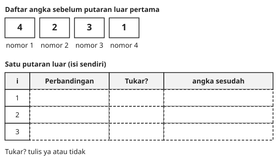

**Ingat dulu:** Tanpa melihat modul:

1. Tulis strategi tukar tetangga dalam satu kalimat. ______
2. Daftar `nilai` berisi 30, 15, 20. Apa `item (2) of [nilai]` dan `length of [nilai]`? ______
3. `repeat (3)` berisi dua blok `move`. Berapa kali `move` berjalan? ______



`[Gambar: empat kotak daftar angka berisi 4, 2, 3, 1 dengan nomor 1 sampai 4. Di bawahnya tabel dengan kolom i, Perbandingan, Tukar?, dan angka sesudah; tiga baris dengan i = 1, 2, 3; kolom lain kosong.]`

**Prediksi:** Untuk menukar dua isi daftar diperlukan `tmp`, tempat sementara. Program B untuk daftar `angka` berisi 4, 2, 3, 1:

```text
when green flag clicked
delete all of [angka]
add [4] to [angka]
add [2] to [angka]
add [3] to [angka]
add [1] to [angka]
repeat (3)
  set [i] to (1)
  repeat (3)
    if <(item (i) of [angka]) > (item ((i) + (1)) of [angka])> then
      set [tmp] to (item (i) of [angka])
      replace item (i) of [angka] with (item ((i) + (1)) of [angka])
      replace item ((i) + (1)) of [angka] with (tmp)
    change [i] by (1)
```

Bayangkan `repeat` luar hanya berjalan **satu kali**. Isi `angka` sesudahnya: ______

Telusuri satu putaran luar dengan tabel pada gambar. Kartu terbesar ke mana sesudah satu putaran? ______

**Lengkapi:** Satu putaran untuk daftar `angka` berisi 3, 1, 2. Isi bagian kosong, lalu telusuri.

```text setengah-jadi
set [i] to (1)
repeat (2)
  if <(item (i) of [angka]) > (item ((i) + (1)) of [angka])> then
    set [tmp] to (item (i) of [angka])
    replace item (i) of [angka] with (item ((i) + (1)) of [angka])
    replace item ((i) + (1)) of [angka] with (______)
  change [i] by (______)
```

Isi `angka` sesudahnya: ______

**Susun:** Empat baris penukaran berikut diacak. Susun menjadi blok yang menukar isi nomor `i` dan nomor `i + 1` bila isi nomor `i` lebih besar.

- **A.** `if <(item (i) of [angka]) > (item ((i) + (1)) of [angka])> then`
- **B.** `  set [tmp] to (item (i) of [angka])` (di dalam `if`)
- **C.** `  replace item (i) of [angka] with (item ((i) + (1)) of [angka])` (di dalam `if`)
- **D.** `  replace item ((i) + (1)) of [angka] with (tmp)` (di dalam `if`)

Urutanku: ______ , ______ , ______ , ______

Mengapa B harus sebelum C? ______

**Latihan:**

1. Pada program B, ganti `>` menjadi `<`. Prediksi isi akhir `angka` (4, 2, 3, 1), lalu telusuri. ______
2. Ganti `repeat (3)` luar menjadi `repeat (2)`. Apakah daftar 4, 2, 3, 1 sudah urut? Telusuri. ______
3. Hapus `set [i] to (1)` dari dalam putaran luar dan letakkan sebelum `repeat` luar. Apa yang salah pada putaran kedua? ______
4. Dengan dua kalimat, jelaskan mengapa `tmp` diperlukan. ______

**Cek diri:**

- [ ] Aku bisa menulis penukaran dengan `tmp`.
- [ ] Aku bisa menelusuri dua `repeat` bersarang.
- [ ] Aku bisa menjelaskan jumlah putaran.

**Catatan cetak (untuk guru, tidak dicetak):** satu lembar A4, dua halaman. Kunci ada di modul `SMP7-2-M6`, bagian "Contoh terselesaikan", "Contoh setengah jadi", dan "Cek mandiri". AI: tanpa AI. Lembar tidak memuat kolom nama, kelas, tanggal, atau nilai.
