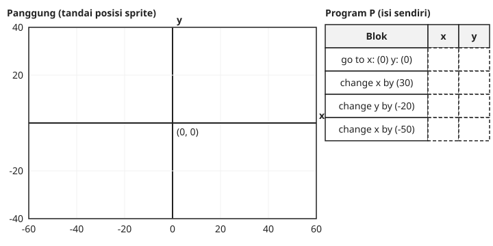

**Ingat dulu:** Tanpa melihat modul:

1. Tulis `if` yang menggeser sprite ke kanan bila tombol panah kanan ditekan, dan sebut kapan kondisi diperiksa. ______
2. Mengapa menukar dua isi daftar butuh `tmp`? ______
3. Sebut arah dalam derajat untuk atas, kanan, bawah, dan kiri. ______



`[Gambar: bidang koordinat dengan sumbu x dari -60 sampai 60 dan sumbu y dari -40 sampai 40, berpotongan di (0, 0). Di kanannya tabel dengan kolom Blok, x, y; empat baris: go to x: 0 y: 0, change x by 30, change y by -20, change x by -50; kolom x dan y kosong.]`

**Prediksi:** Nilai **x** naik ke kanan dan turun ke kiri; nilai **y** naik ke atas dan turun ke bawah. Program P (sprite mulai di (0, 0)):

```text
when green flag clicked
go to x: (0) y: (0)
change x by (30)
change y by (-20)
change x by (-50)
```

Di mana sprite berhenti? ______

Telusuri P, isi tabel pada gambar, dan tandai tiap posisi di bidang koordinat. Sprite bergerak ke bawah atau ke atas saat y negatif? ______

**Lengkapi:** Tambahkan gerak naik dan turun pada Pemain. Isi bagian kosong, lalu sebut arah geraknya.

```text setengah-jadi
forever
  if <key [up arrow] pressed?> then
    change y by (______)
  if <key [down arrow] pressed?> then
    change y by (______)
```

**Susun:** Lima baris berikut diacak. Susun menjadi skrip Pemain yang bergerak ke kanan bila tombol panah kanan ditekan.

- **A.** `when green flag clicked`
- **B.** `go to x: (-50) y: (0)`
- **C.** `forever`
- **D.** `  if <key [right arrow] pressed?> then` (di dalam `forever`)
- **E.** `    change x by (10)` (di dalam `if`)

Urutanku: ______ , ______ , ______ , ______ , ______

Mengapa `go to` harus sebelum `forever`? ______

**Latihan:**

1. Tambahkan ke Pemain: bila `touching [Musuh]`, ucapkan "Kena!" satu detik lalu kembali ke awal. ______
2. Tulis `if` yang memindahkan Pemain ke x = -200 bila `x position` lebih besar dari 200. ______
3. Hapus `forever` dari skrip Pemain. Apa yang terjadi saat tombol kanan ditekan sesudah program mulai? Mengapa? ______
4. Dengan dua kalimat, jelaskan beda `change x by` dan `go to x:`. ______

**Cek diri:**

- [ ] Aku bisa menelusuri posisi (x, y) sprite.
- [ ] Aku bisa menulis gerak dengan tombol.
- [ ] Aku bisa menulis akibat `touching`.

**Catatan cetak (untuk guru, tidak dicetak):** satu lembar A4, dua halaman. Kunci ada di modul `SMP7-2-M7`, bagian "Contoh terselesaikan", "Contoh setengah jadi", dan "Cek mandiri". AI: tanpa AI. Lembar tidak memuat kolom nama, kelas, tanggal, atau nilai.
