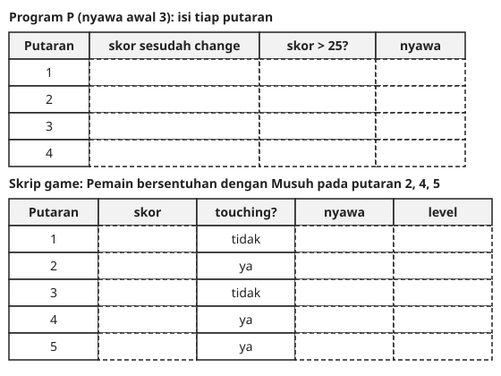

**Ingat dulu:** Tanpa melihat modul:

1. Tulis blok yang membuat Pemain kembali ke titik awal bila menyentuh Musuh. ______
2. Jelaskan beda `set` dan `change`, lalu tulis blok yang menambah `skor` 10. ______
3. Tulis blok yang menyiapkan `skor` dan menambahnya bila kondisi benar. ______



`[Gambar: tabel pertama untuk program P dengan kolom Putaran, skor sesudah change, skor > 25?, dan nyawa; empat baris, kolom selain Putaran kosong. Tabel kedua untuk skrip game dengan kolom Putaran, skor, touching?, nyawa, dan level; lima baris, kolom touching? sudah terisi tidak, ya, tidak, ya, ya; kolom lain kosong.]`

**Prediksi:** `set` dipakai sekali di awal supaya permainan mulai dari nilai yang sama; `change` dipakai tiap ada peristiwa. Program P:

```text
when green flag clicked
set [skor] to (0)
set [nyawa] to (3)
repeat (4)
  change [skor] by (10)
  if <(skor) > (25)> then
    change [nyawa] by (-1)
```

`skor` pada akhirnya: ______ . `nyawa` pada akhirnya: ______

Telusuri P dan isi tabel pertama pada gambar. Pada putaran berapa nyawa pertama kali berkurang, dan mengapa? ______

**Lengkapi:** Pemain mendapat satu nyawa tambahan tepat saat skor mencapai 10. Isi bagian kosong, lalu jelaskan mengapa memakai `change`, bukan `set`.

```text setengah-jadi
if <(skor) = (______)> then
  change [nyawa] by (______)
```

Alasan: ______

**Susun:** Tujuh baris berikut diacak. Susun menjadi skrip yang mengakhiri permainan bila nyawa habis.

- **A.** `    change [nyawa] by (-1)` (di dalam `if`)
- **B.** `stop [all]`
- **C.** `repeat until <(nyawa) < (1)>`
- **D.** `set [nyawa] to (3)`
- **E.** `  if <touching [Musuh]?> then` (di dalam `repeat until`)
- **F.** `when green flag clicked`
- **G.** `say [Permainan selesai] for (2) seconds`

Urutanku: ______ , ______ , ______ , ______ , ______ , ______ , ______

Mengapa `say` ada sesudah `repeat until`, bukan di dalamnya? ______

**Latihan:**

1. Pada skrip game (tabel kedua), ganti `set [nyawa] to (3)` menjadi `set [nyawa] to (2)`. Telusuri. Pada putaran berapa permainan selesai, dan berapa skor akhirnya? ______
2. Tambahkan sprite Koin. Bila Pemain `touching [Koin]`, skor bertambah 5. ______
3. Tulis `if` yang membuat `level` menjadi 2 bila `skor` lebih dari 9, memakai `set`. ______
4. Dengan dua kalimat, jelaskan kapan memakai `set` dan kapan `change` untuk `skor` dan `nyawa`. ______

**Cek diri:**

- [ ] Aku bisa menyiapkan skor, nyawa, dan level.
- [ ] Aku bisa menelusuri tiga variabel dalam satu tabel.
- [ ] Aku bisa mengakhiri permainan bila nyawa habis.

**Catatan cetak (untuk guru, tidak dicetak):** satu lembar A4, dua halaman. Kunci ada di modul `SMP7-2-M8`, bagian "Contoh terselesaikan", "Contoh setengah jadi", dan "Cek mandiri". AI: tanpa AI oleh murid. Lembar tidak memuat kolom nama, kelas, tanggal, atau nilai.
