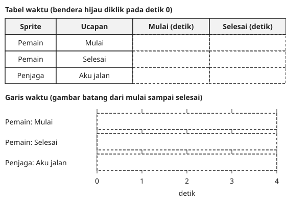

**Ingat dulu:** Tanpa melihat modul:

1. Apa yang membuat `repeat until <(nyawa) < (1)>` berhenti? ______
2. Mengapa `if <touching [Musuh]?>` dibungkus `forever`? ______
3. Apa beda data dan informasi? Beri satu contoh. ______



`[Gambar: tabel dengan kolom Sprite, Ucapan, Mulai (detik), Selesai (detik); tiga baris: Pemain Mulai, Pemain Selesai, Penjaga Aku jalan; kolom waktu kosong. Di bawahnya garis waktu dengan tanda 0 sampai 4 detik dan tiga lajur kosong untuk menggambar batang tiap ucapan.]`

**Prediksi:** `broadcast [giliran]` mengirim pesan ke semua sprite; sprite yang punya `when I receive [giliran]` lalu menjalankan skripnya. Pengirim tidak menunggu penerima.

Sprite Pemain:

```text
when green flag clicked
say [Mulai] for (1) seconds
broadcast [giliran]
say [Selesai] for (1) seconds
```

Sprite Penjaga:

```text
when I receive [giliran]
say [Aku jalan] for (2) seconds
```

Pada detik berapa tiap ucapan muncul dan berakhir (bendera hijau diklik pada detik 0)? Isi tabel waktu pada gambar, lalu gambar batangnya di garis waktu. Apakah "Selesai" menunggu "Aku jalan"? ______

**Lengkapi:** Bila `nyawa` habis, Pemain memberi tahu Musuh supaya hilang. Nama pesan di pengirim dan di penerima harus **sama persis**. Isi bagian kosong dengan nama pesan yang sama.

```text setengah-jadi
if <(nyawa) < (1)> then
  broadcast [______]
```

```text setengah-jadi
when I receive [______]
hide
```

**Susun:** Enam baris berikut diacak. Susun menjadi skrip klon Musuh yang bergerak lalu dihapus. Klon adalah salinan sprite yang dibuat saat program berjalan.

- **A.** `delete this clone`
- **B.** `repeat (5)`
- **C.** `when I start as a clone`
- **D.** `  change x by (-20)` (di dalam `repeat`)
- **E.** `show`
- **F.** `go to x: (100) y: (0)`

Urutanku: ______ , ______ , ______ , ______ , ______ , ______

Mengapa `delete this clone` ada paling akhir? ______

**Latihan:**

1. Pada program Pemain dan Penjaga, ganti `broadcast` dengan `broadcast and wait`. Tulis lagi waktu mulai dan selesai ketiga ucapan. ______
2. Saat tombol spasi ditekan, Pemain mengirim pesan `mulai`; Musuh menerimanya dan menjalankan `go to x: (50) y: (0)`. Tulis kedua skripnya. ______
3. Pengirim memakai pesan `giliran`, penerima memakai `gilirn` (kurang satu huruf). Apa yang terjadi pada Penjaga, dan mengapa? ______
4. Dengan dua kalimat, jelaskan beda `broadcast` dan `broadcast and wait`. ______

**Cek diri:**

- [ ] Aku bisa menulis pesan dan penerimanya.
- [ ] Aku bisa membedakan `broadcast` dan `broadcast and wait`.
- [ ] Aku bisa menjelaskan apa itu klon.

**Catatan cetak (untuk guru, tidak dicetak):** satu lembar A4, dua halaman. Kunci ada di modul `SMP7-2-M9`, bagian "Contoh terselesaikan", "Contoh setengah jadi", dan "Cek mandiri". AI: tanpa AI oleh murid. Lembar tidak memuat kolom nama, kelas, tanggal, atau nilai.
