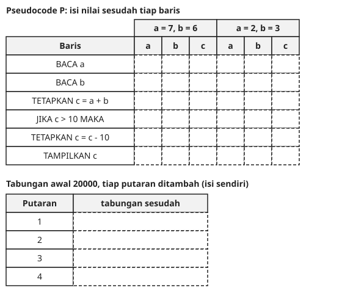

**Ingat dulu:** Tanpa melihat modul:

1. Tulis langkah-langkah, dalam kalimat singkat, untuk mencari angka terbesar dari tiga angka. ______
2. Kapan sebuah `if` menjalankan isinya? ______
3. Tulis arti **dekomposisi** dengan kalimatmu sendiri. ______



`[Gambar: tabel dengan kolom Baris dan dua kelompok kolom a, b, c untuk masukan a = 7, b = 6 dan a = 2, b = 3. Enam baris: BACA a, BACA b, TETAPKAN c = a + b, JIKA c > 10 MAKA, TETAPKAN c = c - 10, TAMPILKAN c; sel nilai kosong. Di bawahnya tabel Putaran 1 sampai 4 dan kolom tabungan sesudah, kosong.]`

**Prediksi:** *Pseudocode* menulis langkah dengan kosakata terbatas dan tidak dijalankan komputer. `BACA x` mengambil satu nilai masukan ke `x`; `TETAPKAN x = ...` mengisi `x`; `JIKA ... MAKA` menjalankan baris menjorok bila kondisi benar; `TAMPILKAN x` menuliskan hasilnya. Pseudocode P:

```text
Pseudocode:
BACA a
BACA b
TETAPKAN c = a + b
JIKA c > 10 MAKA
  TETAPKAN c = c - 10
TAMPILKAN c
```

Bila `a` = 7 dan `b` = 6, yang ditampilkan: ______ . Bila `a` = 2 dan `b` = 3: ______

Telusuri dan isi tabel pertama pada gambar. Baris `JIKA` dilewati pada yang mana, dan mengapa? ______

**Lengkapi:** Tabungan awal dibaca; tiap minggu ditambah Rp5.000 selama 4 minggu; tampilkan tabungan akhir. Isi bagian kosong.

```text setengah-jadi
Pseudocode:
BACA tabungan
ULANGI ______ KALI
  TETAPKAN tabungan = tabungan + ______
TAMPILKAN tabungan
```

Telusuri dengan tabungan awal 20000 pada tabel kedua di gambar.

**Susun:** Enam baris berikut diacak. Susun menjadi pseudocode yang menampilkan angka yang lebih besar dari dua angka.

- **A.** `BACA a`
- **B.** `BACA b`
- **C.** `JIKA a > b MAKA`
- **D.** `  TAMPILKAN a` (menjorok di bawah `JIKA`)
- **E.** `LAINNYA`
- **F.** `  TAMPILKAN b` (menjorok di bawah `LAINNYA`)

Urutanku: ______ , ______ , ______ , ______ , ______ , ______

Mengapa `BACA` harus sebelum `JIKA`? ______

**Latihan:**

Soal pensil: harga Rp2.000 per buah; bila membeli 10 buah atau lebih, total dipotong Rp5.000.

1. Ganti syarat potongan menjadi 8 buah atau lebih. Berapa total untuk `n` = 8? ______
2. Tiket masuk Rp3.000; bila umur kurang dari 12, harga Rp1.500. Tulis pseudocode dan telusuri untuk umur 10 dan 12. ______
3. Tiga nilai dibaca; tampilkan rata-ratanya. Tulis pseudocode dan telusuri untuk 3, 6, dan 9. ______
4. Dengan dua kalimat, jelaskan mengapa pseudocode memakai kata yang itu-itu saja. ______

**Cek diri:**

- [ ] Aku bisa mengubah soal cerita pendek menjadi pseudocode.
- [ ] Aku bisa menelusuri pseudocode dengan tabel nilai.
- [ ] Aku bisa menyebut mengapa kosakata dibatasi.

**Catatan cetak (untuk guru, tidak dicetak):** satu lembar A4, dua halaman. Kunci ada di modul `SMP8-1-M1`, bagian "Contoh terselesaikan", "Contoh setengah jadi", dan "Cek mandiri". AI: tanpa AI. Lembar tidak memuat kolom nama, kelas, tanggal, atau nilai.
