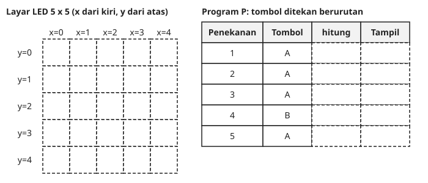

**Ingat dulu:** Tanpa melihat modul:

1. Sebut padanan MakeCode untuk `when green flag clicked`, `forever`, dan `say`. ______
2. Sebut komponen sistem komputer: masukan, proses, keluaran, dan tempat menyimpan. Beri satu contoh tiap komponen. ______
3. Mengapa komputer menyimpan data dengan dua nilai, 0 dan 1? ______



`[Gambar: layar LED lima kali lima; kolom x = 0 sampai 4 dari kiri, baris y = 0 sampai 4 dari atas; semua kotak kosong. Di kanannya tabel dengan kolom Penekanan, Tombol, hitung, Tampil; lima baris dengan tombol A, A, A, B, A; kolom hitung dan Tampil kosong.]`

**Prediksi:** Masukan (tombol, sensor) masuk ke proses (programmu), lalu keluar sebagai keluaran (lampu, bunyi). Isi `on button A pressed` hanya dijalankan tiap kali tombol A ditekan. Program P:

```text
on start
  set hitung to 0
on button A pressed
  change hitung by 1
  show number hitung
on button B pressed
  set hitung to 0
  show number hitung
```

Tombol ditekan berurutan: A, A, A, B, A. Angka yang tampil sesudah tiap penekanan: ______ , ______ , ______ , ______ , ______

Telusuri dan isi tabel pada gambar. Apa yang terjadi pada `hitung` saat tombol B ditekan? ______

**Lengkapi:** Program L menyalakan satu lampu tiap A ditekan, bergeser ke kanan di baris 2, dan menjaga batas. Isi bagian kosong, lalu sebut `kolom` sesudah A ditekan enam kali.

```text setengah-jadi
on button A pressed
  if kolom < ______ then
    plot x kolom y 2
    change kolom by 1
on button B pressed
  clear screen
  set kolom to ______
```

`kolom` sesudah A ditekan enam kali: ______

**Susun:** Lima baris berikut diacak. Susun menjadi program yang menampilkan banyaknya tombol A ditekan.

- **A.** `on start`
- **B.** `  set hitung to 0` (di dalam `on start`)
- **C.** `on button A pressed`
- **D.** `  change hitung by 1` (di dalam `on button A pressed`)
- **E.** `  show number hitung` (di dalam `on button A pressed`, sesudah `change`)

Urutanku: ______ , ______ , ______ , ______ , ______

Mengapa `show number` ada sesudah `change`? ______

**Latihan:**

1. Pada program P, ganti `change hitung by 1` menjadi `change hitung by 2`. Berapa yang tampil sesudah A, A, A? ______
2. Tulis program: tombol B menyalakan lampu pojok kiri bawah (x 0, y 4), dan tombol A mematikannya dengan `unplot x 0 y 4`. Tandai lampunya pada layar di gambar. ______
3. Telusuri P untuk urutan A, A, B, A, A. Angka apa saja yang tampil? ______
4. Mana yang masukan dan mana yang keluaran: tombol A, layar LED, sensor suhu, bunyi dari pengeras suara, menggoyangkan papan? ______

**Cek diri:**

- [ ] Aku bisa membedakan masukan dan keluaran.
- [ ] Aku bisa menelusuri program yang menunggu tombol.
- [ ] Aku bisa memakai koordinat x dan y layar.

**Catatan cetak (untuk guru, tidak dicetak):** satu lembar A4, dua halaman. Kunci ada di modul `SMP8-1-M10`, bagian "Contoh terselesaikan", "Contoh setengah jadi", dan "Cek mandiri". AI: tanpa AI. Lembar tidak memuat kolom nama, kelas, tanggal, atau nilai.
