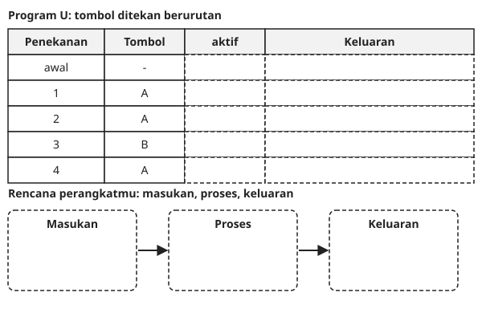

**Ingat dulu:** Tanpa melihat modul:

1. Tulis satu kasus uji, masukan dan hasil diharapkan, untuk alarm yang berbunyi bila tombol A ditekan. ______
2. Sebut dua masukan dan dua keluaran pada micro:bit simulator. ______
3. Sebut lima langkah mencari kesalahan dari menjalankan sampai uji ulang. ______



`[Gambar: tabel dengan kolom Penekanan, Tombol, aktif, Keluaran; baris awal dan empat penekanan A, A, B, A; kolom aktif dan Keluaran kosong. Di bawahnya tiga kotak kosong berlabel Masukan, Proses, Keluaran, dihubungkan panah.]`

**Prediksi:** Program U adalah alarm sederhana: tombol A menyalakan, tombol B mematikan, dan `forever` memeriksa terus-menerus.

```text
on start
  set aktif to 0
on button A pressed
  set aktif to 1
on button B pressed
  set aktif to 0
forever
  if aktif = 1 then
    show string "ALARM"
    play tone (Middle C) for (1) beat
  else
    clear screen
```

Tombol ditekan berurutan: A, A, B, A. Berapa `aktif` sesudah tiap penekanan, dan apa yang terjadi pada layar? Tulis dulu: ______

Lalu telusuri dan isi tabel pada gambar.

**Lengkapi:** Rencana kerja perangkatmu sendiri. Pilihan: alarm, atau penghitung langkah (tiap langkah menambah satu pada hitungan yang tampil; di simulator, tombol A boleh mewakili satu langkah). Isi tabel; kotak Masukan, Proses, Keluaran pada gambar boleh dipakai.

| Bagian rencana | Isimu |
| --- | --- |
| Tujuan satu kalimat | |
| Masukan, proses, keluaran | |
| Bagian kecil (3 sampai 4) | |
| Blok yang dipakai | |
| Tiga kasus uji | |
| Pembagian kerja | |
| Penyederhanaan | |
| Bahan orang lain dan izinnya | |

**Latihan:**

1. Tunjukkan tabel rencana di atas ke gurumu sebelum membuat. ______
2. Susun program dari bagian kecil. Uji tiap bagian sebelum menggabungkannya. ______
3. Jalankan tiga kasus ujimu. Tulis catatan penyebab untuk yang gagal (gejala, penyebab, perbaikan, aturan umum). ______
4. Tulis laporan satu halaman dengan enam bagian: judul dan pembuat samaran, tujuan, cara memakai, hasil uji, perbaikan, dan bahan orang lain. ______
5. Jelaskan perangkatmu lisan dalam satu menit: tujuan, masukan dan keluaran, satu penyederhanaan, dan satu galat yang kamu temukan. ______

**Cek diri:**

- [ ] Aku punya rencana kerja sebelum membuat.
- [ ] Aku menguji dengan tiga kasus.
- [ ] Aku menulis penyebab untuk setiap yang gagal.

**Catatan cetak (untuk guru, tidak dicetak):** satu lembar A4, dua halaman. Bagian "Susun" dilewati karena minggu proyek tidak punya satu program berurutan (sama seperti modul). Kunci ada di modul `SMP8-1-M11`, bagian "Contoh terselesaikan" dan "Cek mandiri". AI: tanpa AI oleh murid. Lembar tidak memuat kolom nama, kelas, tanggal, atau nilai; laporan memakai pembuat samaran.
