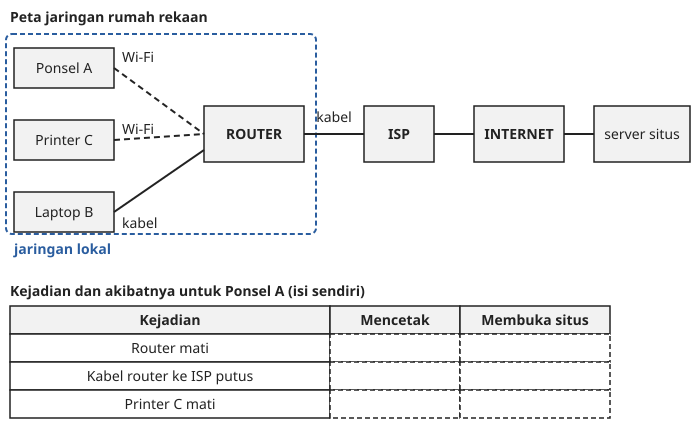

**Ingat dulu:** Tanpa melihat modul:

1. Gambar diagram masukan, proses, keluaran, dan penyimpanan untuk satu perangkat, lalu beri satu contoh tiap komponen. ______
2. Sebut dua masukan dan dua keluaran pada micro:bit simulator. ______
3. Sebut tiga hal yang tidak boleh ada di karya yang dibagikan. ______



`[Gambar: Ponsel A dan Printer C tersambung ke router lewat Wi-Fi (garis putus-putus), Laptop B lewat kabel. Ponsel, printer, laptop, dan router berada dalam kotak jaringan lokal. Router tersambung kabel ke ISP, lalu INTERNET, lalu server situs. Di bawahnya tabel dengan kolom Kejadian, Mencetak, Membuka situs; tiga baris: Router mati, Kabel router ke ISP putus, Printer C mati; kolom Mencetak dan Membuka situs kosong.]`

**Prediksi:** **Jaringan lokal** adalah beberapa perangkat yang saling tersambung di satu tempat, lewat kabel atau Wi-Fi. **Internet** adalah banyak jaringan yang saling tersambung di seluruh dunia. Untuk tiap kejadian pada tabel di gambar, tulis apakah Ponsel A masih bisa mencetak ke Printer C dan membuka situs.

Jalur Ponsel A ke Printer C: ______

Jalur Ponsel A ke server situs: ______

Perangkat mana yang dilewati kedua jalur itu bersama? ______

**Lengkapi:** Lengkapi peta rekaan berikut.

```text setengah-jadi
Ponsel A ~~Wi-Fi~~> ______ ----> ______ ----> internet
Laptop B ---kabel---> ______
Bila ______ mati, Ponsel A dan Laptop B tidak bisa saling mengirim berkas.
```

**Susun:** Enam langkah perjalanan satu permintaan halaman diacak. Susun menjadi urutan yang masuk akal.

- **A.** Halaman tampil di ponselmu.
- **B.** Ponsel mengirim permintaan lewat Wi-Fi ke router rumah.
- **C.** Server situs menyiapkan halaman dan mengirimnya kembali dalam potongan kecil.
- **D.** Kamu mengetik alamat situs di ponsel.
- **E.** Router meneruskan permintaan ke ISP, lalu melewati banyak jaringan sampai ke server situs.
- **F.** Potongan itu menempuh jalur sebaliknya dan disusun kembali di ponselmu.

Urutanku: ______ , ______ , ______ , ______ , ______ , ______

Mengapa router dilewati dua kali, sebelum dan sesudah ke ISP? ______

**Latihan:**

1. Tambahkan Tablet D yang memakai Wi-Fi ke peta. Tulis satu baris petanya dan sebut apa yang terjadi pada Tablet D bila router mati. ______
2. Wi-Fi rumah mati. Apakah ponsel dengan data seluler masih bisa membuka situs? Bagaimana laptop yang hanya memakai Wi-Fi rumah? Beri alasan. ______
3. Sebut satu keuntungan sambungan kabel dan satu keuntungan sambungan nirkabel. ______
4. Dengan dua kalimat, jelaskan beda jaringan lokal dan internet. ______

**Cek diri:**

- [ ] Aku bisa menyebut peran router dan ISP.
- [ ] Aku bisa menggambar peta jaringan dengan jalur ke internet.
- [ ] Aku bisa membedakan jaringan lokal dan internet.

**Catatan cetak (untuk guru, tidak dicetak):** satu lembar A4, dua halaman. Kunci ada di modul `SMP8-1-M12`, bagian "Contoh terselesaikan", "Contoh setengah jadi", dan "Cek mandiri". AI: tanpa AI. Lembar tidak memuat kolom nama, kelas, tanggal, atau nilai.
