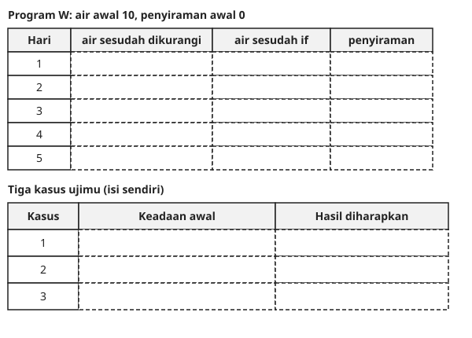

**Ingat dulu:** Tanpa melihat modul:

1. Tulis bagian-bagian laporan satu halaman untuk proyek mini. ______
2. Tulis rencana kerja untuk proyek mini: tujuan, bagian kecil, dan tiga kasus uji. ______
3. Kapan isi `on button A pressed` dijalankan? ______



`[Gambar: tabel pertama dengan kolom Hari, air sesudah dikurangi, air sesudah if, penyiraman; lima baris hari 1 sampai 5; sel kosong. Tabel kedua dengan kolom Kasus, Keadaan awal, Hasil diharapkan; tiga baris kosong.]`

**Prediksi:** Program W adalah simulasi pot tanaman rekaan: tiap hari air berkurang 3; bila air kurang dari 4, tanaman disiram 8. Blok `siram` memakai masukannya.

```text
define siram (jumlah)
  change [air] by (jumlah)

when green flag clicked
set [air] to (10)
set [penyiraman] to (0)
repeat (5)
  change [air] by (-3)
  if <(air) < (4)> then
    siram (8)
    change [penyiraman] by (1)
```

`air` sesudah lima hari: ______ . `penyiraman`: ______

Telusuri dan isi tabel pertama pada gambar. Mengapa hari 2 tidak disiram? ______

**Lengkapi:** Rencana kerja produkmu sendiri (simulasi atau perangkat). Isi tabel; tiga kasus uji boleh ditulis pada tabel kedua di gambar.

| Bagian rencana | Isimu |
| --- | --- |
| Tujuan satu kalimat | |
| Bagian kecil (3 sampai 4) | |
| Blok yang dipakai, termasuk satu blok buatan sendiri | |
| Dua penyederhanaan | |
| Tiga kasus uji | |
| Pembagian kerja | |
| Bahan orang lain dan izinnya | |

**Latihan:**

1. Tunjukkan tabel rencana di atas ke gurumu sebelum membuat. ______
2. Susun produk dari bagian kecil. Uji tiap bagian sebelum menggabungkannya. ______
3. Jalankan tiga kasus ujimu. Tulis catatan penyebab untuk yang gagal (gejala, penyebab, perbaikan, aturan umum). ______
4. Tulis laporan satu halaman dengan enam bagian dan satu kalimat tentang penyederhanaanmu. ______
5. Jelaskan produkmu lisan dalam satu menit: tujuan, bagian kecil, satu penyederhanaan, dan satu galat yang kamu temukan. ______

**Cek diri:**

- [ ] Aku punya rencana kerja sebelum membuat.
- [ ] Aku menyebut dua penyederhanaan produkku.
- [ ] Aku menguji dengan tiga kasus dan mencatat penyebab yang gagal.

**Catatan cetak (untuk guru, tidak dicetak):** satu lembar A4, dua halaman. Bagian "Susun" dilewati karena minggu proyek tidak punya satu program berurutan (sama seperti modul). Kunci ada di modul `SMP8-1-M13`, bagian "Contoh terselesaikan" dan "Cek mandiri". AI: tanpa AI oleh murid. Lembar tidak memuat kolom nama, kelas, tanggal, atau nilai; laporan memakai pembuat samaran.
