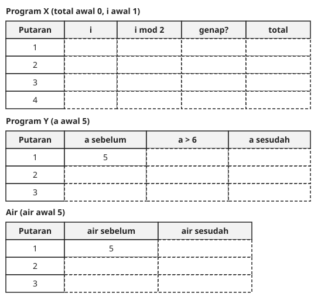

**Ingat dulu:** Kerjakan tanpa catatan dan tanpa AI. Soal-soal ini kembali dari minggu 1 sampai 12 semester ini.

1. Tarif parkir Rp2.000 per jam; bila 3 jam atau lebih, total dipotong Rp1.000. Tulis pseudocode dengan masukan jam, lalu telusuri jam 2 dan jam 4. ______
2. Sprite menjalankan `move (20) steps` lalu `turn right (15) degrees`, ditulis empat kali berturut-turut. Rapikan: tulis `define` dan panggilannya. ______
3. Program micro:bit: `A` menambah `hitung` 1 dan menampilkannya; `B` mengisi `hitung` 0 dan menampilkannya. Tombol ditekan A, A, B, A. Angka apa yang tampil? ______
4. Sebut urutan perangkat dari ponsel sampai server situs. ______



`[Gambar: tiga tabel penelusuran. Tabel program X: putaran 1 sampai 4 dengan kolom i, i mod 2, genap?, total, kosong. Tabel program Y: putaran 1 sampai 3 dengan kolom a sebelum (putaran 1 berisi 5), a > 6, a sesudah. Tabel air: putaran 1 sampai 3 dengan kolom air sebelum (putaran 1 berisi 5) dan air sesudah.]`

**Prediksi:** Tulis prediksimu sebelum menelusuri. Program X:

```text
when green flag clicked
set [total] to (0)
set [i] to (1)
repeat (4)
  if <((i) mod (2)) = (0)> then
    change [total] by (i)
  change [i] by (1)
```

`total` pada akhirnya: ______ . `i` pada akhirnya: ______

Telusuri per putaran pada tabel pertama di gambar.

**Lengkapi:** Isi sendiri tabel penelusuran untuk program Y pada tabel kedua di gambar.

```text
when green flag clicked
set [a] to (5)
repeat (3)
  if <(a) > (6)> then
    change [a] by (-2)
  else
    change [a] by (3)
```

`a` sesudah putaran 3: ______

**Latihan:** Kerjakan tanpa catatan dan tanpa AI. Periksa dengan kunci hanya sesudah selesai.

1. Tulis program dari ingatan: `nyawa` awal 3, tiap putaran berkurang 1 selama 4 putaran, dan sprite mengucap "Habis" bila `nyawa` kurang dari 1. ______
2. Program: `set [jumlah] to (0)`, lalu `repeat (3)` berisi `change [jumlah] by (2)` dan `say (jumlah) for (1) seconds`. Harapannya hanya 6 yang diucapkan. Tulis catatan penyebab dan perbaikannya. ______
3. `set [air] to (5)`, lalu `repeat (3)` berisi `change [air] by (-2)` dan `if <(air) < (2)> then change [air] by (5)`. Berapa `air` sesudah tiap putaran? Pakai tabel ketiga di gambar. ______
4. Tulis tiga kasus uji untuk program parkir pada soal 1 "Ingat dulu": jam 1, jam 3 (batas), dan jam 5, beserta hasil diharapkan. ______

**Cek diri:**

- [ ] Aku menjawab sebelum melihat kunci.
- [ ] Aku menandai soal yang salah dan menyebut sebabnya.
- [ ] Aku menulis satu hal yang akan kulatih ulang.

**Catatan cetak (untuk guru, tidak dicetak):** satu lembar A4, dua halaman. Bagian "Susun" dilewati karena minggu ini berisi kuis mengingat, bukan penyusunan program (sama seperti modul). Kunci ada di modul `SMP8-1-M14`, bagian "Ingat kembali", "Contoh terselesaikan", dan "Catatan untuk guru". AI: tanpa AI. Jurnal refleksi pada "Cek mandiri" modul ditulis di kertas sendiri, tidak dikumpulkan. Lembar tidak memuat kolom nama, kelas, tanggal, atau nilai.
