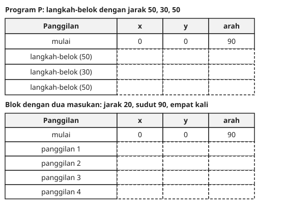

**Ingat dulu:** Tanpa melihat modul:

1. Tulis pseudocode tiga baris yang membaca dua angka dan menampilkan jumlahnya. ______
2. Berapa derajat putar tiap sudut untuk menggambar segitiga sama sisi, dan mengapa? ______
3. Apa yang dikerjakan `repeat (4)` bila isinya `move (10) steps`? ______



`[Gambar: dua tabel dengan kolom Panggilan, x, y, arah. Tabel pertama: baris mulai (0, 0, 90) lalu tiga panggilan langkah-belok dengan jarak 50, 30, 50; sel x, y, arah kosong. Tabel kedua: baris mulai (0, 0, 90) lalu panggilan 1 sampai 4; sel kosong.]`

**Prediksi:** Di Scratch, kategori My Blocks memungkinkan kamu memberi nama pada sekumpulan blok. Isinya ditulis sekali di bawah `define`, lalu dipanggil seperti blok biasa. Program P (sprite mulai di (0, 0)):

```text
define langkah-belok (jarak)
move (jarak) steps
turn right (90) degrees

when green flag clicked
go to x: (0) y: (0)
point in direction (90)
langkah-belok (50)
langkah-belok (30)
langkah-belok (50)
```

Sprite berhenti di: ______ , menghadap: ______

Telusuri dan isi tabel pertama pada gambar. Berapa kali `move` dijalankan? ______

**Lengkapi:** Buat blok `segitiga` untuk segitiga sama sisi. Isi bagian kosong, lalu tulis dua panggilan: `segitiga (30)` dan `segitiga (60)`.

```text setengah-jadi
define segitiga (sisi)
repeat (______)
  move (sisi) steps
  turn right (______) degrees
```

**Susun:** Lima baris berikut diacak. Susun menjadi program utama yang menggambar satu persegi berukuran 30 memakai blok `persegi`.

- **A.** `when green flag clicked`
- **B.** `go to x: (0) y: (0)`
- **C.** `point in direction (90)`
- **D.** `pen down`
- **E.** `persegi (30)`

Urutanku: ______ , ______ , ______ , ______ , ______

Mengapa `pen down` harus sebelum `persegi (30)`? ______

**Latihan:**

1. Tulis blok `segitiga-sama-sisi (sisi)` lengkap dengan dua panggilan. ______
2. Tulis blok `langkah-belok (jarak) (sudut)` dengan dua masukan, lalu panggil empat kali dengan (20) dan (90). Telusuri pada tabel kedua di gambar. Apa bentuknya? ______
3. Pada blok `persegi (sisi)`, ganti `move (sisi) steps` menjadi `move (40) steps`. Apa yang terjadi pada `persegi (20)`? Mengapa? ______
4. Dengan dua kalimat, jelaskan beda `define` dan panggilan blok. ______

**Cek diri:**

- [ ] Aku bisa menulis blok buatan sendiri dengan satu masukan.
- [ ] Aku bisa menelusuri posisi dan arah sprite sesudah panggilan.
- [ ] Aku bisa menjelaskan manfaat nama blok yang jelas.

**Catatan cetak (untuk guru, tidak dicetak):** satu lembar A4, dua halaman. Kunci ada di modul `SMP8-1-M2`, bagian "Contoh terselesaikan", "Contoh setengah jadi", dan "Cek mandiri". AI: tanpa AI. Lembar tidak memuat kolom nama, kelas, tanggal, atau nilai.
