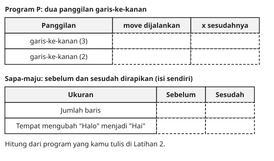

**Ingat dulu:** Tanpa melihat modul:

1. Jelaskan satu manfaat merapikan program berulang dengan blok buatan sendiri. ______
2. Tulis pseudocode yang menampilkan "lulus" bila nilai 60 atau lebih, dan "ulang" bila tidak. ______
3. Tulis aturan sudut putar untuk bentuk beraturan n sisi, dan hitung untuk n = 5. ______



`[Gambar: tabel pertama dengan kolom Panggilan, move dijalankan, x sesudahnya; dua baris garis-ke-kanan (3) dan garis-ke-kanan (2); sel kosong. Tabel kedua dengan kolom Ukuran, Sebelum, Sesudah; dua baris: jumlah baris, dan tempat mengubah "Halo" menjadi "Hai"; sel kosong.]`

**Prediksi:** **Abstraksi** berarti memakai sesuatu lewat namanya tanpa memikirkan isinya lagi. Program P (sprite mulai di (0, 0), menghadap 90):

```text
define garis-ke-kanan (n)
repeat (n)
  move (10) steps

when green flag clicked
go to x: (0) y: (0)
point in direction (90)
garis-ke-kanan (3)
garis-ke-kanan (2)
```

Jumlah `move` yang dijalankan seluruhnya: ______ . Sprite berhenti di x = ______

Telusuri dan isi tabel pertama pada gambar. Apa yang berubah antar panggilan, dan apa yang tetap? ______

**Lengkapi:** Rapikan program lama dua segitiga sisi 40 berikut.

```text
when green flag clicked
point in direction (90)
pen up
go to x: (-30) y: (0)
pen down
repeat (3)
  move (40) steps
  turn right (120) degrees
pen up
go to x: (30) y: (0)
pen down
repeat (3)
  move (40) steps
  turn right (120) degrees
```

Isi bagian kosong:

```text setengah-jadi
define segitiga-di (x) (y)
pen up
go to x: (______) y: (______)
pen down
repeat (3)
  move (40) steps
  turn right (120) degrees

when green flag clicked
point in direction (90)
segitiga-di (-30) (0)
segitiga-di (______) (______)
```

**Susun:** Enam langkah merapikan program diacak. Susun menjadi urutan yang masuk akal.

- **A.** Cari bagian program yang berulang.
- **B.** Tandai bagian yang berbeda antar pengulangan.
- **C.** Beri nama dan jadikan bagian yang berbeda sebagai masukan.
- **D.** Pindahkan bagian yang sama ke dalam `define`.
- **E.** Ganti bagian lama dengan panggilan.
- **F.** Jalankan dan bandingkan hasilnya dengan sebelum dirapikan.

Urutanku: ______ , ______ , ______ , ______ , ______ , ______

Mengapa langkah F dilakukan? ______

**Latihan:**

1. Tambahkan masukan `ukuran` pada `kotak-di` sehingga `move` memakai `ukuran`, lalu panggil dengan ukuran 30, 20, dan 10 di tiga tempat berbeda. ______
2. Program lama: `when green flag clicked` lalu tiga kali berturut-turut `say [Halo] for (2) seconds` dan `move (10) steps`. Tulis blok `sapa-maju` dan program utamanya. ______
3. Untuk soal 2, hitung baris sebelum dan sesudah pada tabel kedua di gambar. Apakah lebih pendek? Berapa tempat diubah bila "Halo" menjadi "Hai"? ______
4. Dengan dua kalimat, jelaskan beda *apa* yang dikerjakan blok dan *bagaimana* ia mengerjakannya. ______

**Cek diri:**

- [ ] Aku bisa menemukan bagian yang berulang dan yang berbeda.
- [ ] Aku bisa merapikan program dengan blok bermasukan.
- [ ] Aku bisa menjelaskan *apa* versus *bagaimana*.

**Catatan cetak (untuk guru, tidak dicetak):** satu lembar A4, dua halaman. Kunci ada di modul `SMP8-1-M3`, bagian "Contoh terselesaikan", "Contoh setengah jadi", dan "Cek mandiri". AI: tanpa AI. Lembar tidak memuat kolom nama, kelas, tanggal, atau nilai.
