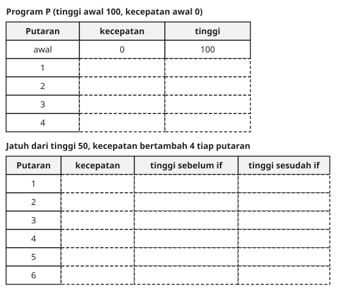

**Ingat dulu:** Tanpa melihat modul:

1. Tulis program yang mengubah satu variabel tiap putaran dalam perulangan, lalu telusuri hasilnya dalam tabel. ______
2. Tulis blok `lompat (jarak)` yang menggeser sprite ke atas sebanyak `jarak`. ______
3. Apa beda `set` dan `change` pada variabel? ______



`[Gambar: tabel pertama dengan kolom Putaran, kecepatan, tinggi; baris awal berisi 0 dan 100, lalu putaran 1 sampai 4 kosong. Tabel kedua dengan kolom Putaran, kecepatan, tinggi sebelum if, tinggi sesudah if; enam baris putaran, semua sel kosong.]`

**Prediksi:** Simulasi meniru sesuatu dengan aturan sederhana yang diulang. Tiap putaran kecepatan bertambah, lalu tinggi berkurang sebesar kecepatan itu. Satuannya kiasan dan hambatan udara diabaikan. Program P:

```text
when green flag clicked
set [tinggi] to (100)
set [kecepatan] to (0)
repeat (4)
  change [kecepatan] by (5)
  change [tinggi] by ((0) - (kecepatan))
```

`tinggi` sesudah empat putaran: ______ . `kecepatan`: ______

Telusuri dan isi tabel pertama pada gambar. Berapa berkurangnya tinggi di tiap putaran, dan apakah selalu sama? ______

**Lengkapi:** Siklus air yang disederhanakan: menguap, mengembun, hujan, lalu mulai lagi. Isi bagian kosong.

```text setengah-jadi
set [fase] to (1)
repeat (5)
  if <(fase) = (1)> then
    say [menguap] for (1) seconds
  if <(fase) = (2)> then
    say [mengembun] for (1) seconds
  if <(fase) = (3)> then
    say [hujan] for (1) seconds
  change [fase] by (1)
  if <(fase) > (______)> then
    set [fase] to (______)
```

Kata yang diucapkan pada putaran 1 sampai 5: ______

**Susun:** Enam baris berikut diacak. Susun menjadi program benda jatuh dari tinggi 50 dengan kecepatan bertambah 6 tiap putaran.

- **A.** `set [tinggi] to (50)`
- **B.** `set [kecepatan] to (0)`
- **C.** `repeat until <(tinggi) < (1)>`
- **D.** `  change [kecepatan] by (6)` (di dalam `repeat until`)
- **E.** `  change [tinggi] by ((0) - (kecepatan))` (di dalam `repeat until`)
- **F.** `  if <(tinggi) < (0)> then set [tinggi] to (0)` (di dalam `repeat until`)

Urutanku: ______ , ______ , ______ , ______ , ______ , ______

Mengapa `set` ada di luar perulangan? ______

**Latihan:**

1. Pada program jatuh bebas di atas, ganti penambahan kecepatan 6 menjadi 4 (tinggi awal 50). Telusuri pada tabel kedua di gambar; berapa putaran sampai tinggi menjadi 0? ______
2. Tulis simulasi bak mandi: air 0 liter, tiap putaran bertambah 8 liter, berhenti bila air lebih dari 29, dan air tidak boleh melebihi 30. Berapa putaran? ______
3. Pada program P, tukar urutan dua baris di dalam `repeat` (ubah tinggi dulu, lalu kecepatan). Berapa `tinggi` dan `kecepatan` sesudah empat putaran? ______
4. Sebut dua hal yang disederhanakan oleh simulasi jatuh bebas ini. ______

**Cek diri:**

- [ ] Aku bisa menelusuri variabel simulasi per putaran.
- [ ] Aku bisa menjaga nilai di batas.
- [ ] Aku bisa menyebut apa yang disederhanakan simulasiku.

**Catatan cetak (untuk guru, tidak dicetak):** satu lembar A4, dua halaman. Kunci ada di modul `SMP8-1-M4`, bagian "Contoh terselesaikan", "Contoh setengah jadi", dan "Cek mandiri". AI: tanpa AI. Lembar tidak memuat kolom nama, kelas, tanggal, atau nilai.
