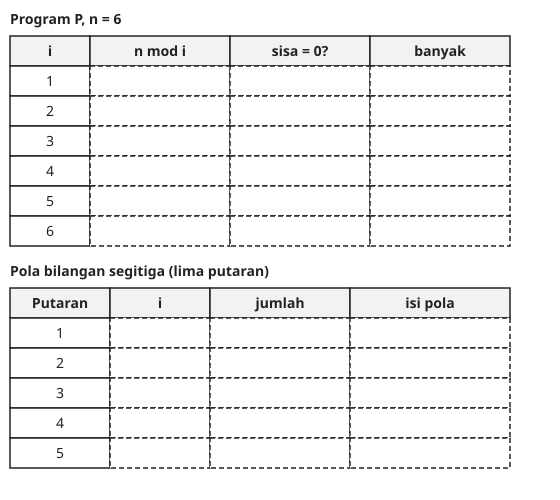

**Ingat dulu:** Tanpa melihat modul:

1. Tulis pseudocode dengan `ULANGI 5 KALI` yang menampilkan jumlah 1 + 2 + 3 + 4 + 5. ______
2. Telusuri `set [a] to (0)`, lalu `repeat (4)` berisi `change [a] by (3)`; tulis nilai `a` per putaran. ______
3. Barisan 2, 4, 6, 8: tulis aturan umumnya. ______



`[Gambar: tabel pertama dengan kolom i, n mod i, sisa = 0?, banyak; enam baris i = 1 sampai 6, sel lain kosong. Tabel kedua dengan kolom Putaran, i, jumlah, isi pola; lima baris putaran 1 sampai 5, sel lain kosong.]`

**Prediksi:** `(a) mod (b)` memberi **sisa** a dibagi b; misalnya 10 mod 3 = 1. Sebuah bilangan b adalah **faktor** dari n bila n mod b = 0. Program P:

```text
when green flag clicked
set [n] to (6)
set [i] to (1)
set [banyak] to (0)
repeat (n)
  if <((n) mod (i)) = (0)> then
    change [banyak] by (1)
  change [i] by (1)
```

`banyak` pada akhirnya: ______

Telusuri dan isi tabel pertama pada gambar. Bilangan mana saja yang membuat sisanya 0? ______

**Lengkapi:** Pola bilangan segitiga: 1, 3, 6, 10, 15. Isi bagian kosong, lalu isi tabel kedua pada gambar.

```text setengah-jadi
set [jumlah] to (0)
set [i] to (0)
delete all of [pola]
repeat (5)
  change [i] by (1)
  change [jumlah] by (______)
  add (______) to [pola]
```

Isi `pola` sesudah program selesai: ______

**Susun:** Tujuh baris berikut diacak. Susun menjadi program yang menyimpan faktor n = 10 ke daftar `faktor`.

- **A.** `set [n] to (10)`
- **B.** `delete all of [faktor]`
- **C.** `set [i] to (1)`
- **D.** `repeat (n)`
- **E.** `  if <((n) mod (i)) = (0)> then` (di dalam `repeat`)
- **F.** `    add (i) to [faktor]` (di dalam `if`)
- **G.** `  change [i] by (1)` (di dalam `repeat`, sesudah `if`)

Urutanku: ______ , ______ , ______ , ______ , ______ , ______ , ______

Mengapa `change [i]` ada sesudah `if`, bukan di dalamnya? ______

**Latihan:**

1. Ganti `n` menjadi 15 pada program faktor. Tulis isi `faktor` dan banyaknya. ______
2. Tambahkan di akhir program faktor: bila `faktor` berisi tepat dua nilai, ucapkan "prima", bila tidak "bukan". Apa hasilnya untuk n = 13 dan n = 9? ______
3. Ubah program pola agar menghasilkan bilangan persegi 1, 4, 9, 16, 25. ______
4. Pada program faktor dengan n = 10, ganti `repeat (n)` menjadi `repeat (5)`. Faktor apa yang hilang, dan mengapa? ______

**Cek diri:**

- [ ] Aku bisa memakai `mod` untuk menguji faktor.
- [ ] Aku bisa menelusuri program faktor dengan tabel.
- [ ] Aku bisa menulis program pola bilangan.

**Catatan cetak (untuk guru, tidak dicetak):** satu lembar A4, dua halaman. Kunci ada di modul `SMP8-1-M5`, bagian "Contoh terselesaikan", "Contoh setengah jadi", dan "Cek mandiri". AI: tanpa AI. Lembar tidak memuat kolom nama, kelas, tanggal, atau nilai.
