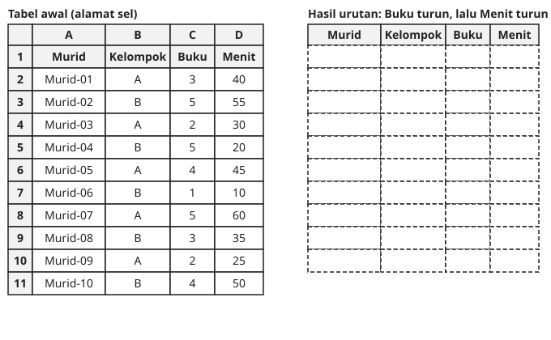

**Ingat dulu:** Tanpa melihat modul:

1. Sebut beda data dan informasi, dan beri satu contoh data diskrit dari tabel kelas. ______
2. Urutkan 5, 2, 9, 1 dari kecil ke besar dan sebut caramu. ______
3. Bilangan b adalah faktor dari n bila apa? ______

`[Gambar: tabel kiri dengan kolom A sampai D (Murid, Kelompok, Buku, Menit), baris 1 judul, baris 2 sampai 11 berisi Murid-01 sampai Murid-10 dengan kelompok A atau B, jumlah buku, dan menit. Tabel kanan dengan judul kolom yang sama dan sepuluh baris kosong untuk hasil urutan.]`

**Prediksi:** Lembar kerja adalah tabel: **baris** mendatar, **kolom** menurun, perpotongannya **sel**; alamat sel ditulis huruf kolom lalu nomor baris. **Mengurutkan** menyusun ulang seluruh baris menurut isi satu kolom. **Menyaring** menampilkan hanya baris yang memenuhi syarat.

(a) Urutkan tabel menurut Buku dari terbanyak, dan bila sama menurut Menit dari terbanyak. Tulis hasilnya pada tabel kanan di gambar. Pertama: ______ , terakhir: ______

(b) Disaring Kelompok B dan Buku 4 atau lebih, berapa baris tersisa? ______

**Lengkapi:** Isi bagian kosong dengan menyaring tabel awal.

| Syarat | Murid yang tampil | Banyaknya |
| --- | --- | --- |
| Kelompok A | 01, 03, 05, 07, 09 | 5 |
| Menit 40 atau lebih | | |
| Kelompok A **dan** Menit 40 atau lebih | | |

**Susun:** Lima langkah mengolah tabel diacak. Susun menjadi urutan yang aman.

- **A.** Tulis pertanyaan yang ingin dijawab.
- **B.** Pilih seluruh tabel, termasuk judul kolom.
- **C.** Urutkan atau saring menurut kolom dan syarat yang dipilih.
- **D.** Periksa: jumlah baris dan nama masih bersama angkanya.
- **E.** Tulis jawaban satu kalimat.

Urutanku: ______ , ______ , ______ , ______ , ______

Mengapa langkah D ada? ______

**Latihan:**

1. Urutkan tabel awal menurut Menit dari terkecil. Siapa tiga yang pertama? ______
2. Saring Buku 2 atau kurang. Siapa yang tampil? ______
3. Alamat sel yang berisi jumlah Buku Murid-04: ______
4. Dengan dua kalimat, jelaskan beda mengurutkan dan menyaring. ______

**Cek diri:**

- [ ] Aku bisa mengurutkan dengan dua kunci dan memeriksa hasilnya.
- [ ] Aku bisa menyaring dengan satu atau dua syarat.
- [ ] Aku bisa menulis jawaban dari hasil olahan.

**Catatan cetak (untuk guru, tidak dicetak):** satu lembar A4, dua halaman. Kunci ada di modul `SMP8-1-M6`, bagian "Contoh terselesaikan", "Contoh setengah jadi", dan "Cek mandiri". AI: tanpa AI. Lembar tidak memuat kolom nama, kelas, tanggal, atau nilai.
