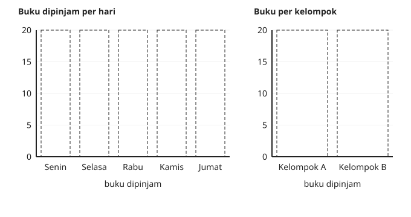

**Ingat dulu:** Tanpa melihat modul:

1. Sebut tiga langkah menjaga baris tetap utuh saat mengurutkan tabel. ______
2. Beri satu contoh data diskrit dan satu contoh yang bukan. ______
3. Apa itu asumsi pada sebuah simulasi? ______



`[Gambar: dua bidang grafik batang kosong. Bidang kiri berlabel Senin, Selasa, Rabu, Kamis, Jumat; bidang kanan berlabel Kelompok A dan Kelompok B. Sumbu tegak 0 sampai 20 dengan garis bantu tiap 5; batang digambar sendiri.]`

**Prediksi:** **Grafik batang** membandingkan kategori; **grafik garis** menunjukkan perubahan menurut urutan waktu. Total buku yang dipinjam: Kelompok A 16 buku, Kelompok B 18 buku. Grafik berikut digambar dengan teks; satu `#` adalah satu buku **di atas 14**, bukan dari 0.

```text
Total buku dipinjam per kelompok (sumbu mulai dari 14)
Kelompok A | ##     16
Kelompok B | ####   18
```

Pada gambar teks itu, batang B tampak berapa kali batang A? ______ . Berapa kali sebenarnya 18 dibanding 16? ______

Mengapa gambar dan angka berbeda jauh? ______

**Lengkapi:** Suhu rekaan sebuah hari: 06.00 24, 09.00 27, 12.00 31, 15.00 29 (derajat Celsius). Karena berurutan menurut waktu, pilih grafik garis. Isi bagian kosong.

```text setengah-jadi
Kesimpulan: Suhu tertinggi ______ derajat Celsius pada pukul ______;
dari 06.00 sampai 12.00 suhu naik ______ derajat.
Batas: data hanya empat pengukuran pada satu hari.
```

**Susun:** Tujuh langkah membuat grafik diacak. Susun menjadi urutan yang masuk akal.

- **A.** Tulis pertanyaan yang ingin dijawab.
- **B.** Pilih data dan kolom yang dibutuhkan.
- **C.** Pilih jenis grafik menurut pertanyaan.
- **D.** Buat grafiknya.
- **E.** Beri judul, label sumbu, dan satuan.
- **F.** Periksa sumbu mulai dari 0 dan cocokkan tinggi batang dengan tabel.
- **G.** Tulis satu kesimpulan beserta batasnya.

Urutanku: ______ , ______ , ______ , ______ , ______ , ______ , ______

Mengapa pertanyaan ditulis lebih dulu? ______

**Latihan:**

Data rekaan satu pekan (buku dipinjam): Senin 6, Selasa 9, Rabu 5, Kamis 14, Jumat 12.

1. Gambar grafik batang pekan itu pada bidang kiri di gambar (sumbu dari 0) dan tulis satu kesimpulan. ______
2. Gambar grafik batang total buku per kelompok (A 16, B 18) pada bidang kanan, lalu tulis satu kesimpulan beserta batasnya. ______
3. Pada grafik soal 2, batang B tampak berapa kali batang A? Bandingkan dengan gambar di "Prediksi". ______
4. Jenis grafik apa untuk (a) banyak murid tiap cara ke sekolah, dan (b) suhu tiap jam? Beri alasan. ______

**Cek diri:**

- [ ] Aku bisa memilih jenis grafik menurut pertanyaan.
- [ ] Aku bisa mengenali sumbu yang menyesatkan.
- [ ] Aku bisa menulis kesimpulan beserta batasnya.

**Catatan cetak (untuk guru, tidak dicetak):** satu lembar A4, dua halaman. Kunci ada di modul `SMP8-1-M7`, bagian "Contoh terselesaikan", "Contoh setengah jadi", dan "Cek mandiri". AI: tanpa AI. Lembar tidak memuat kolom nama, kelas, tanggal, atau nilai.
