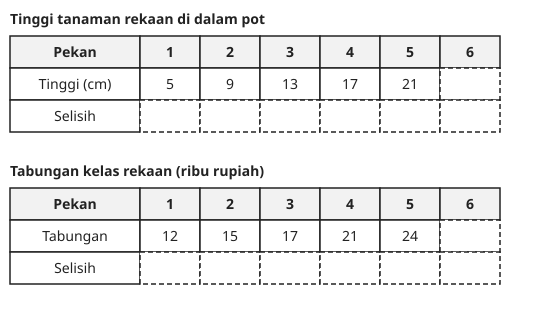

**Ingat dulu:** Tanpa melihat modul:

1. Jelaskan beda mengurutkan dan menyaring dengan satu contoh. ______
2. Sebut dua hal yang harus ada pada grafik yang jujur. ______
3. Sebut beda data dan informasi. ______



`[Gambar: tabel pertama untuk tinggi tanaman rekaan: pekan 1 sampai 5 bernilai 5, 9, 13, 17, 21 cm; pekan 6 dan baris Selisih kosong. Tabel kedua untuk tabungan kelas rekaan dalam ribu rupiah: pekan 1 sampai 5 bernilai 12, 15, 17, 21, 24; pekan 6 dan baris Selisih kosong.]`

**Prediksi:** **Prediksi** adalah perkiraan nilai yang belum ada, berdasarkan pola pada nilai yang sudah ada. Prediksi bukan kepastian. Pola paling sederhana: nilai naik atau turun dengan selisih yang kira-kira tetap. Lihat tabel tinggi tanaman pada gambar.

(a) Tinggi pada pekan 6: ______

(b) Tinggi pada pekan 40 bila polanya diteruskan: ______

(c) Mana dari dua angka itu yang lebih kamu percaya, dan mengapa? ______

Hitung selisih tiap pekan pada baris Selisih. Apakah angka untuk pekan 40 masuk akal untuk tanaman dalam pot? ______

**Lengkapi:** Sampah kertas kelas rekaan (kg), pekan 1 sampai 5: 6, 9, 12, 14, 18. Isi bagian kosong.

```text setengah-jadi
Selisih tiap pekan: 3, 3, 2, ______
Jumlah selisih: ______    Selisih rata-rata: ______ / 4 = ______
Prediksi pekan 6: 18 + ______ = ______
Rentang: dari 18 + ______ sampai 18 + ______
Batas: ______
```

**Susun:** Tujuh langkah membuat prediksi diacak. Susun menjadi urutan yang masuk akal.

- **A.** Tulis nilai apa yang ingin diprediksi dan untuk kapan.
- **B.** Lihat datanya, lebih baik dalam grafik garis, dan periksa apakah ada pola.
- **C.** Hitung selisih tiap pasangan nilai berurutan.
- **D.** Hitung selisih rata-rata.
- **E.** Tambahkan selisih rata-rata ke nilai terakhir.
- **F.** Tulis rentang dari selisih terkecil dan terbesar.
- **G.** Tulis alasan dan batas prediksi.

Urutanku: ______ , ______ , ______ , ______ , ______ , ______ , ______

Mengapa pola dilihat sebelum menghitung? ______

**Latihan:**

1. Data buku dipinjam pekan 1 sampai 5: 30, 34, 37, 42, 44. Hitung selisih, selisih rata-rata, prediksi pekan 6, dan rentangnya. ______
2. Tabungan kelas pada tabel kedua di gambar: buat prediksi pekan 6 beserta rentang dan satu kalimat batas. ______
3. Mengapa prediksi pekan 40 pada data tanaman sebaiknya tidak dipercaya, walaupun hitungannya benar? ______
4. Mana yang cocok memakai rata-rata semua nilai sebagai prediksi, dan mana yang cocok memakai selisih rata-rata? (a) nilai ulangan lima kali: 70, 75, 72, 74, 71; (b) tinggi tanaman yang naik hampir tetap tiap pekan. ______

**Cek diri:**

- [ ] Aku bisa menghitung selisih rata-rata.
- [ ] Aku bisa menulis prediksi sebagai rentang.
- [ ] Aku bisa menyebut batas sebuah prediksi.

**Catatan cetak (untuk guru, tidak dicetak):** satu lembar A4, dua halaman. Kunci ada di modul `SMP8-1-M8`, bagian "Contoh terselesaikan", "Contoh setengah jadi", dan "Cek mandiri". AI: tanpa AI. Lembar tidak memuat kolom nama, kelas, tanggal, atau nilai.
