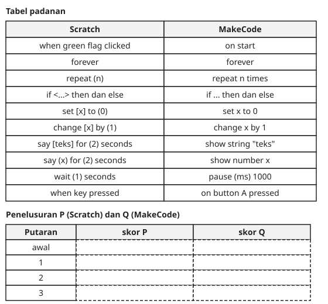

**Ingat dulu:** Tanpa melihat modul:

1. Sebut satu contoh perulangan dan satu contoh kondisi yang pernah kamu tulis di Scratch. ______
2. Sebut tiga langkah menghitung prediksi dengan selisih rata-rata. ______
3. Jelaskan beda `define` dan panggilan blok. ______



`[Gambar: tabel padanan sepuluh baris dengan kolom Scratch dan MakeCode, misalnya repeat (n) dengan repeat n times, dan wait (1) seconds dengan pause (ms) 1000. Di bawahnya tabel penelusuran dengan kolom Putaran (awal, 1, 2, 3), skor P, dan skor Q; sel skor kosong.]`

**Prediksi:** **MakeCode** adalah editor blok untuk micro:bit dengan simulator di peramban. Di sini program MakeCode ditulis dengan teks, satu baris satu blok, menjorok untuk blok di dalam blok.

Program Scratch P:

```text
when green flag clicked
set [skor] to (0)
repeat (3)
  change [skor] by (4)
say (skor) for (2) seconds
```

Program MakeCode Q:

```text
on start
  set skor to 0
  repeat 3 times
    change skor by 4
  show number skor
```

Yang ditampilkan P: ______ . Yang ditampilkan Q di layar LED simulator: ______ . Sama atau berbeda? ______

Telusuri keduanya dan isi tabel penelusuran pada gambar. Baris mana pada P dan Q yang berpasangan? ______

**Lengkapi:** Terjemahkan program Scratch berikut ke MakeCode dengan tabel padanan. Isi bagian kosong.

```text
when green flag clicked
repeat (3)
  say [Halo] for (1) seconds
```

```text setengah-jadi
on start
  repeat ______ times
    show string "Halo"
    pause (ms) ______
```

**Susun:** Lima baris program MakeCode berikut diacak. Susun menjadi satu program yang menampilkan 10 di akhir.

- **A.** `on start`
- **B.** `  set skor to 0` (di dalam `on start`)
- **C.** `  repeat 5 times` (di dalam `on start`)
- **D.** `    change skor by 2` (di dalam `repeat`)
- **E.** `  show number skor` (di dalam `on start`, sesudah `repeat`)

Urutanku: ______ , ______ , ______ , ______ , ______

Mengapa `show number` ada di luar `repeat`? ______

**Latihan:**

1. Scratch: `set [nilai] to (7)`, lalu `if <(nilai) > (8)> then say [Tinggi] else say [Rendah]`. Terjemahkan ke MakeCode. Apa yang ditampilkan untuk nilai 7? ______
2. Terjemahkan ke MakeCode: `set [x] to (10)`, lalu `repeat (4)` berisi `change [x] by (-2)`, lalu `say (x) for (2) seconds`. Berapa yang ditampilkan? ______
3. Seorang murid menulis `pause (ms) 2` karena ingin menunggu 2 detik. Berapa lama sebenarnya, dan bagaimana memperbaikinya? ______
4. Dengan dua kalimat, jelaskan apa yang sama dan apa yang beda antara program Scratch dan terjemahannya. ______

**Cek diri:**

- [ ] Aku bisa memakai tabel padanan untuk menerjemahkan program kecil.
- [ ] Aku bisa menelusuri dua program dan membandingkan hasilnya.
- [ ] Aku ingat bahwa `pause` memakai milidetik.

**Catatan cetak (untuk guru, tidak dicetak):** satu lembar A4, dua halaman. Kunci ada di modul `SMP8-1-M9`, bagian "Contoh terselesaikan", "Contoh setengah jadi", dan "Cek mandiri". AI: tanpa AI. Lembar tidak memuat kolom nama, kelas, tanggal, atau nilai.
