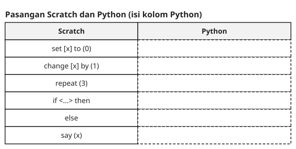

**Ingat dulu:** Tanpa melihat catatan, jawab dengan kata-katamu. (a) Ubah pseudocode `ULANGI 3 KALI` berisi `TAMPILKAN "Halo"` menjadi blok Scratch. (b) Telusuri `set [a] to (0)`, lalu `repeat (4)` berisi `change [a] by (3)`: berapa `a` akhirnya?

______



`[Gambar: tabel dua kolom, Scratch dan Python. Kolom Scratch berisi enam blok: set [x] to (0), change [x] by (1), repeat (3), if <...> then, else, say (x). Kolom Python kosong; tulis baris Python yang berpasangan dengan tiap blok.]`

**Prediksi:** Program Scratch P dan Python Q dibuat sepasang.

```text
when green flag clicked
set [skor] to (0)
repeat (3)
  change [skor] by (4)
say (skor) for (2) seconds
```

```python
skor = 0
for putaran in range(3):
    skor = skor + 4
print(skor)
```

Apa yang ditampilkan P? ______ Apa yang dicetak Q? ______ Sama atau berbeda? ______

Telusuri dengan tabel, lalu cocokkan:

| putaran | skor |
| --- | --- |
| 1 | |
| 2 | |
| 3 | |

**Lengkapi:** Terjemahkan program Scratch `repeat (3)` berisi `say [Halo] for (1) seconds`.

```python setengah-jadi
for putaran in range(______):
    print("______")
```

Berapa baris yang tercetak? ______

**Susun:** Empat baris Python berikut diacak. Susun menjadi program yang mencetak 10 di akhir.

- **A.** `skor = 0`
- **B.** `for putaran in range(5):`
- **C.** `    skor = skor + 2` (menjorok di bawah `for`)
- **D.** `print(skor)` (di kolom paling kiri, sesudah perulangan)

Urutanku: ______ , ______ , ______ , ______

Mengapa `print` tidak menjorok? ______

**Latihan:** (tanpa AI)

1. Pada program `nilai = 7` dengan `if nilai > 5:` lalu `print("Tinggi")` dan `else:` lalu `print("Rendah")`, ganti `> 5` menjadi `> 8`. Apa yang dicetak? ______
2. Terjemahkan ke Python: `set [x] to (10)`, lalu `repeat (4)` berisi `change [x] by (-2)`, lalu `say (x)`. Berapa yang dicetak? ______
3. Seorang murid menulis `if nilai = 5:` dan Python menolaknya. Apa yang keliru dan bagaimana memperbaikinya? ______
4. Dengan dua kalimat, jelaskan satu hal yang sama dan satu hal yang beda antara program Scratch dan terjemahannya. ______

**Cek diri:**

- [ ] Aku bisa memasangkan blok Scratch dengan baris Python.
- [ ] Aku bisa menelusuri program Python pendek dengan tabel.
- [ ] Aku ingat titik dua dan jorokan.

**Catatan cetak (untuk guru, tidak dicetak):** satu lembar A4, satu sampai dua halaman. Kunci ada di modul `SMP8-2-M1`, bagian "Contoh terselesaikan", "Catatan untuk guru", dan "Cek mandiri". Lembar tidak memuat kolom nama, kelas, tanggal, atau nilai.
