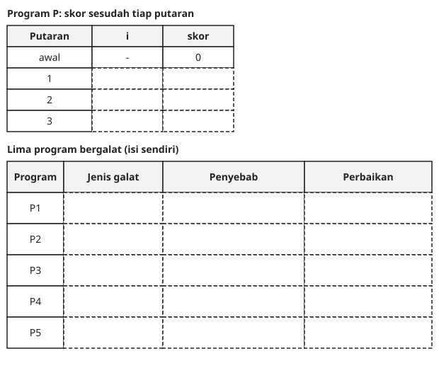

**Ingat dulu:** Tanpa melihat modul:

1. Sebut dua kesalahan penulisan `if` yang membuat Python menolak program. ______
2. Jelaskan apa yang terjadi bila fungsi `kuadrat(x)` dipanggil dengan dua argumen, `kuadrat(2, 3)`. ______
3. Sebut lima langkah mencari kesalahan dari menjalankan sampai uji ulang. ______



`[Gambar: tabel pertama dengan kolom Putaran, i, skor; baris awal (- dan 0) lalu putaran 1 sampai 3 kosong. Tabel kedua dengan kolom Program, Jenis galat, Penyebab, Perbaikan; lima baris P1 sampai P5; sel kosong.]`

**Prediksi:** Python berhenti dan menulis **pesan galat** bila ia tidak bisa melanjutkan. Program P:

```python
skor = 0
for i in range(3):
    skor = skor + i
print("Skor:", skor)
print(skorr)
```

Apakah ada yang tercetak sebelum program berhenti? ______ . Menurutmu apa isi pesan galatnya? ______

Telusuri nilai `skor` tiap putaran pada tabel pertama di gambar. Bagian pesan mana yang menyebut baris, dan bagian mana yang menyebut jenis galat? ______

**Lengkapi:** Program ini punya satu galat dan satu bagian kosong. Perbaiki galatnya dan isi bagian kosong agar mencetak rata-rata.

```python setengah-jadi
nilai = [70, 80, 90]
total = 0
for n in nilai
    total = total + n
print("Rata-rata:", total / ______)
```

Catatan penyebab galatnya: ______

**Susun:** Lima baris berikut diacak. Susun menjadi program yang membaca satu angka lalu mencetak `Tidak bisa dibagi nol` bila angkanya 0, selain itu mencetak `100` dibagi angka itu.

- **A.** `angka = int(input())`
- **B.** `if angka == 0:`
- **C.** `    print("Tidak bisa dibagi nol")` (menjorok di bawah `if`)
- **D.** `else:`
- **E.** `    print(100 / angka)` (menjorok di bawah `else`)

Urutanku: ______ , ______ , ______ , ______ , ______

Apa yang tercetak untuk masukan 0 dan 4? ______

**Latihan:**

1. Lima program bergalat berikut. Untuk tiap program tulis jenis galat, penyebab, dan perbaikan pada tabel kedua di gambar.

   ```text
   P1
   skor = 7
   if skor > 5
       print("tinggi")

   P2
   for i in range(3):
   print(i)

   P3
   umur = 12
   print("Umur: " + umur)

   P4
   daftar = [1, 2, 3]
   print(daftar[3])

   P5
   angka = 0
   print(10 / angka)
   ```

2. Program `angka = int(input())` dijalankan dan diketik `abc`. Jenis galat apa yang muncul dan mengapa? ______
3. Tulis program kecil dengan satu galat sengaja. Tukar dengan temanmu dan cari galatnya dengan langkah mencari kesalahan. ______
4. Mengapa pesan galat dibaca dari baris terakhir lebih dulu? ______

**Cek diri:**

- [ ] Aku membaca baris terakhir lebih dulu.
- [ ] Aku menulis catatan penyebab sebelum mengubah program.
- [ ] Aku mengubah satu hal lalu menguji ulang.

**Catatan cetak (untuk guru, tidak dicetak):** satu lembar A4, dua halaman. Kunci ada di modul `SMP8-2-M10`, bagian "Contoh terselesaikan", "Contoh setengah jadi", dan "Cek mandiri". AI: tanpa AI; murid tidak menempelkan galat ke layanan AI. Lembar tidak memuat kolom nama, kelas, tanggal, atau nilai.
