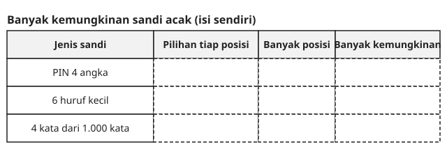

**Ingat dulu:** Tanpa melihat catatan: (a) sebut satu kebiasaan aman saat memakai Wi-Fi yang tidak kamu kenal; (b) sebut tiga bagian pesan galat Python dan urutan membacanya.

______

`[Gambar: tabel empat kolom (Jenis sandi, Pilihan tiap posisi, Banyak posisi, Banyak kemungkinan) dengan tiga baris: PIN 4 angka, 6 huruf kecil, 4 kata dari 1.000 kata. Tiga kolom terakhir kosong; isi dengan hitunganmu.]`

**Prediksi:** Dua sandi rekaan untuk akun rekaan `Murid-01`: **A** `Kucing1!` dan **B** `kopi hujan sepatu biru`. A memakai huruf besar, angka, dan tanda; B hanya huruf kecil dan spasi, tetapi 22 karakter. Menurutmu sandi mana yang lebih sulit ditebak orang lain? Tulis alasanmu: ______

**Lengkapi:** Kartu praktik amanmu sendiri untuk akun rekaan.

| Kartu | Isimu |
| --- | --- |
| Panjang | ______ |
| Sendiri-sendiri | ______ |
| Rahasia: satu hal yang tidak pernah kuberikan | ______ |
| Waspada pesan: tanda pesan yang kucurigai | ______ |
| AI: dua contoh data yang tidak kutempel | ______ |

**Susun:** Lima langkah berikut diacak. Susun urutan yang masuk akal bila kamu menerima pesan rekaan "kodemu 123456, kirim kodenya ke aku sekarang".

- **A.** Berhenti dan jangan membalas atau membuka tautan.
- **B.** Jangan mengirim kode itu kepada siapa pun.
- **C.** Tunjukkan pesannya kepada orang dewasa atau gurumu.
- **D.** Blokir atau laporkan pengirim lewat fitur layanan.
- **E.** Bila kode sudah terkirim, segera ganti sandi lewat situs atau aplikasi resmi layanan itu.

Urutanku: ______ , ______ , ______ , ______ , ______

Mengapa E paling akhir? ______

**Latihan:** (tanpa AI)

1. Ubah `Kucing1!` menjadi rangkaian empat kata acak. Hitung banyak kemungkinannya bila tiap kata dipilih dari daftar 500 kata. ______
2. Berapa kemungkinan PIN 6 angka, dan berapa kali lebih banyak dari PIN 4 angka? ______
3. Dengan dua kalimat, jelaskan mengapa data pribadi dan kata sandi tidak ditempel ke layanan AI, bahkan saat guru yang mendemonstrasikan. ______

**Cek diri:**

- [ ] Aku bisa menghitung banyak kemungkinan sandi acak.
- [ ] Aku punya kartu praktik aman dengan kata-kataku sendiri.
- [ ] Aku tahu data apa yang tidak ditempel ke layanan AI.

**Catatan cetak (untuk guru, tidak dicetak):** satu lembar A4, satu sampai dua halaman. Kunci ada di modul `SMP8-2-M11`, bagian "Contoh terselesaikan", "Catatan untuk guru", dan "Cek mandiri". Lembar tidak memuat kolom nama, kelas, tanggal, atau nilai.
