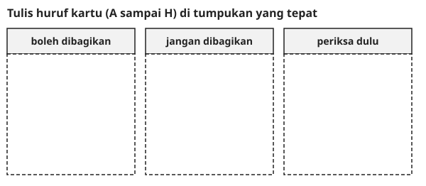

**Ingat dulu:** Tanpa melihat catatan: (a) beri satu contoh data pribadi yang tidak boleh ditempel ke layanan AI, dan alasannya; (b) sebut tiga hal yang tidak boleh ada di karya yang kamu bagikan.

______

`[Gambar: tiga kotak kosong berjudul "boleh dibagikan", "jangan dibagikan", dan "periksa dulu". Tulis huruf kartu A sampai H di kotak yang tepat.]`

**Prediksi:** Informasi publik boleh dilihat siapa saja; informasi privat menyangkut diri atau keluarga. Delapan kartu rekaan:

- **A.** Foto karya Scratch tanpa wajah, bernama samaran `Murid-01`.
- **B.** Nomor telepon rumah.
- **C.** Alamat rumah dan jam saat kamu sendirian di rumah.
- **D.** Pendapat: "Game ini seru."
- **E.** Foto berseragam yang memperlihatkan wajah dan nama sekolah.
- **F.** Kata sandi sebuah akun.
- **G.** Pesan berantai: "Besok sekolah libur, sebarkan!" tanpa sumber.
- **H.** Pengumuman jadwal ujian yang dimuat di situs resmi sekolah.

Masukkan tiap kartu ke satu tumpukan pada gambar sebelum membaca modul. Tulis satu alasan untuk kartu E: ______

**Lengkapi:** Pilah empat kartu rekaan dengan tabel.

| Kartu | Tumpukan | Alasan |
| --- | --- | --- |
| Foto hasil gambar tangan tanpa nama | ______ | ______ |
| Nama lengkap dan kelas | ______ | ______ |
| Pesan: "Hadiah gratis, klik di sini!" | ______ | ______ |
| Opini: "Lagu itu enak" | ______ | ______ |

**Susun:** Lima langkah berikut diacak. Susun urutan yang masuk akal sebelum membagikan sesuatu.

- **A.** Tulis atau tentukan apa yang mau dibagikan.
- **B.** Periksa apakah ada data pribadi, milikmu atau orang lain.
- **C.** Tentukan siapa yang boleh melihatnya.
- **D.** Hapus atau samarkan bagian yang pribadi.
- **E.** Baru bagikan, atau putuskan tidak jadi.

Urutanku: ______ , ______ , ______ , ______ , ______

Mengapa E paling akhir? ______

**Latihan:** (tanpa AI)

1. Ubah kartu E agar aman dibagikan: apa yang dibuang atau disamarkan, atau apakah sebaiknya tidak dibagikan? ______
2. Untuk kartu G, sebut dua cara memeriksa sebelum menyebarkannya. ______
3. Dengan dua kalimat, sebut beda fakta, opini, dan hoaks dengan satu contoh masing-masing. ______

**Cek diri:**

- [ ] Aku bisa memilah informasi publik dan privat dengan alasan.
- [ ] Aku punya tiga pertanyaan sebelum membagikan.
- [ ] Aku bisa membedakan fakta, opini, dan hoaks.

**Catatan cetak (untuk guru, tidak dicetak):** satu lembar A4, satu sampai dua halaman. Kunci ada di modul `SMP8-2-M12`, bagian "Contoh terselesaikan", "Catatan untuk guru", dan "Cek mandiri". Lembar tidak memuat kolom nama, kelas, tanggal, atau nilai.
