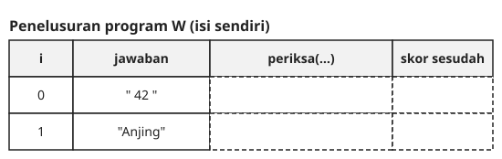

**Ingat dulu:** Tanpa melihat catatan: (a) sebut tiga bagian pesan galat Python dan urutan membacanya; (b) tulis tiga kasus uji untuk kuis dengan satu masukan benar, satu salah, dan satu tepat di batas.

______



`[Gambar: tabel empat kolom (i, jawaban, periksa(...), skor sesudah) dengan dua baris: i = 0 dengan jawaban " 42 ", dan i = 1 dengan jawaban "Anjing". Kolom periksa dan skor sesudah kosong.]`

**Prediksi:** Program W adalah kuis dua soal. Fungsi `periksa` membuang spasi di ujung jawaban, mengubahnya menjadi huruf kecil, lalu membandingkannya dengan kunci.

```python
def periksa(jawaban, benar):
    return jawaban.strip().lower() == benar

soal = ["6 x 7 = ?", "Hewan yang mengeong?"]
kunci = ["42", "kucing"]
skor = 0
for i in range(len(soal)):
    jawaban = input(soal[i] + " ")
    if periksa(jawaban, kunci[i]):
        skor = skor + 1
print("Skor:", skor, "dari", len(soal))
```

Murid mengetik ` 42 ` (dengan spasi) untuk soal 1 dan `Anjing` untuk soal 2. Apa baris terakhir yang tercetak? Tulis dulu: ______

Lalu isi tabel pada gambar.

**Lengkapi:** Rencana kerja kuismu sendiri.

| Bagian rencana | Isimu |
| --- | --- |
| Tujuan satu kalimat | ______ |
| Bagian kecil (3 sampai 4) | ______ |
| Yang dipakai, termasuk satu fungsi dan satu daftar | ______ |
| Tiga kasus uji (benar, salah, di batas) | ______ |
| Pembagian kerja | ______ |
| Bahan orang lain dan izinnya | ______ |

**Latihan:** (tanpa AI)

1. Tulis kuis dengan tiga soal, daftar `soal` dan `kunci`, dan fungsi `periksa`. Uji tiap bagian sebelum menggabungkan. ______
2. Satu kuis memakai kunci `"5.0"` untuk soal `20 / 4`, tetapi jawaban `5` dinilai salah. Tulis catatan penyebab: gejala, penyebab, perbaikan, aturan umum. ______
3. Jelaskan kuismu secara lisan dalam satu menit: tujuan, bagian kecil, satu hal yang kamu temukan, dan satu galat yang kamu perbaiki.

**Cek diri:**

- [ ] Aku punya rencana kerja sebelum membuat.
- [ ] Aku menguji dengan tiga kasus dan mencatat penyebab yang gagal.
- [ ] Aku bisa menjelaskan programku dalam satu menit.

**Catatan cetak (untuk guru, tidak dicetak):** satu lembar A4, satu sampai dua halaman; bagian "Susun" dilewati karena minggu proyek memakai rencana kerja. Kunci ada di modul `SMP8-2-M13`, bagian "Contoh terselesaikan", "Catatan untuk guru", dan "Cek mandiri". Lembar tidak memuat kolom nama, kelas, tanggal, atau nilai.
