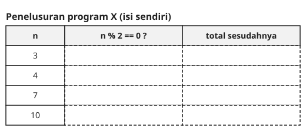

**Ingat dulu:** Tutup semua catatan dan modul. Jawab dulu, baru periksa kunci di modul. (a) Terjemahkan ke Python tanpa melihat tabel pasangan: `set [skor] to (0)`, `repeat (3)` berisi `change [skor] by (2)`, lalu `say (skor)`. (b) Jelaskan mengapa daftar berisi tiga isi berindeks 0, 1, 2, dan apa yang terjadi bila indeks 3 diminta. (c) Jelaskan beda `print` dan `return` di dalam fungsi.

______



`[Gambar: tabel tiga kolom (n, n % 2 == 0 ?, total sesudahnya) dengan empat baris n = 3, 4, 7, dan 10. Dua kolom terakhir kosong.]`

**Prediksi:** Tulis prediksimu sebelum menelusuri. Program X:

```python
def hitung(daftar):
    total = 0
    for n in daftar:
        if n % 2 == 0:
            total = total + n
    return total

print(hitung([3, 4, 7, 10]))
```

Apa yang tercetak? ______

Lalu isi tabel pada gambar: `n`, apakah genap, dan `total` per putaran.

**Lengkapi:** Fungsi yang mencari angka terbesar.

```python setengah-jadi
def terbesar(daftar):
    hasil = daftar[______]
    for n in daftar:
        if n ______ hasil:
            hasil = ______
    return hasil

print(terbesar([4, 9, 2]))
```

Telusuri `terbesar([4, 9, 2])`. Apa yang tercetak? ______

**Latihan:** Kerjakan tanpa catatan dan tanpa AI. Periksa dengan kunci hanya sesudah selesai.

1. Tulis program yang membaca tiga angka ke daftar lalu mencetak yang terbesar tanpa memakai `max`. ______
2. Program: `def jumlah(a, b):` berisi `print(a + b)`, lalu `hasil = jumlah(2, 3)` dan `print(hasil * 2)`. Tulis jenis galat, penyebab, dan perbaikan. ______
3. Tulis tiga kasus uji untuk `terbesar`: terbesar di awal, di akhir, dan semua angka sama, beserta hasil diharapkan. ______

**Cek diri:**

- [ ] Aku menjawab sebelum melihat kunci.
- [ ] Aku menandai soal yang salah dan menyebut sebabnya.
- [ ] Aku menulis satu hal yang akan kulatih ulang.

**Catatan cetak (untuk guru, tidak dicetak):** satu lembar A4, satu sampai dua halaman; bagian "Susun" dilewati karena minggu ini berisi kuis mengingat. Kunci ada di modul `SMP8-2-M14`, bagian "Catatan untuk guru" dan "Cek mandiri". Lembar tidak memuat kolom nama, kelas, tanggal, atau nilai.
