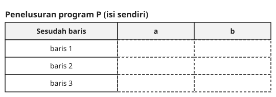

**Ingat dulu:** Tanpa melihat catatan: (a) tulis padanan Python untuk `set [x] to (5)` dan `say (x)`; (b) tulis pseudocode tiga baris yang membaca dua angka dan menampilkan jumlahnya.

______



`[Gambar: tabel tiga kolom (Sesudah baris, a, b) dengan tiga baris bernomor 1 sampai 3. Kolom a dan b kosong; isi dengan nilai sesudah tiap baris program P.]`

**Prediksi:** Tanda `=` berarti mengisi, bukan "sama dengan". Program P:

```python
a = 5
b = a + 2
a = 10
print(a, b)
```

Apa yang dicetak? Tulis dulu prediksimu: ______

Lalu isi tabel pada gambar, sesudah tiap baris. Mengapa `b` tidak ikut berubah ketika `a` diganti? ______

**Lengkapi:** Program yang membaca dua bilangan dan mencetak jumlahnya.

```python setengah-jadi
a = ______(input("Angka pertama? "))
b = int(input("Angka kedua? "))
print("Jumlah:", ______)
```

Telusuri untuk masukan 8 dan 5. Apa yang tercetak? ______

**Susun:** Empat baris berikut diacak. Susun menjadi program yang menghitung dan mencetak total harga pensil.

- **A.** `harga = int(input("Harga satu pensil (Rp)? "))`
- **B.** `banyak = int(input("Berapa pensil? "))`
- **C.** `total = harga * banyak`
- **D.** `print("Total:", total)`

Urutanku: ______ , ______ , ______ , ______

Mengapa C harus sesudah A dan B? ______

**Latihan:** (tanpa AI)

1. Ubah program keliling persegi (`sisi = int(input(...))`, lalu `print("Keliling persegimu:", 4 * sisi, "cm")`) menjadi program luas persegi. Apa yang tercetak untuk sisi 6? ______
2. Tulis program yang membaca umur sebagai bilangan lalu mencetak umur ditambah satu. Telusuri untuk masukan 13. ______
3. Program `umur = input("Umurmu? ")` lalu `print(umur + 1)` berhenti dengan `TypeError`. Apa penyebabnya dan bagaimana memperbaikinya? ______
4. Dengan dua kalimat, jelaskan mengapa pada program P nilai `b` tidak ikut menjadi 12. ______

**Cek diri:**

- [ ] Aku bisa mencetak teks dan hasil hitungan.
- [ ] Aku bisa membaca bilangan dari pengguna dengan `int(input(...))`.
- [ ] Aku bisa menelusuri nilai variabel baris demi baris.

**Catatan cetak (untuk guru, tidak dicetak):** satu lembar A4, satu sampai dua halaman. Kunci ada di modul `SMP8-2-M2`, bagian "Contoh terselesaikan", "Catatan untuk guru", dan "Cek mandiri". Lembar tidak memuat kolom nama, kelas, tanggal, atau nilai.
