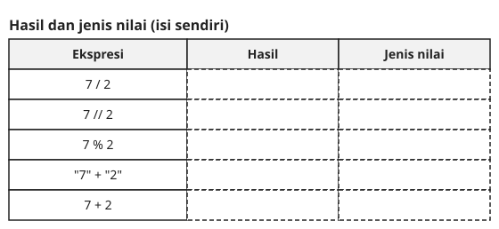

**Ingat dulu:** Tanpa melihat catatan: (a) jelaskan mengapa hasil `input` perlu dibungkus `int(...)` sebelum dijumlahkan; (b) apa beda `=` dan `==` di Python?

______



`[Gambar: tabel tiga kolom (Ekspresi, Hasil, Jenis nilai) dengan lima ekspresi: 7 / 2, 7 // 2, 7 % 2, "7" + "2", dan 7 + 2. Kolom Hasil dan Jenis nilai kosong.]`

**Prediksi:** Operator: `+ - *` tambah, kurang, kali; `/` bagi (hasil desimal); `//` bagi dibulatkan ke bawah; `%` sisa bagi; `**` pangkat. Program P:

```python
a = 7
b = 2
print(a / b, a // b, a % b)
print("7" + "2", 7 + 2)
print(type(a / b), type("7"))
```

Apa yang dicetak pada tiga baris keluaran? Tulis dulu: ______

Isi tabel pada gambar dengan tangan. Mengapa `"7" + "2"` menghasilkan hasil yang berbeda dari `7 + 2`? ______

**Lengkapi:** Program yang mengubah tinggi dalam sentimeter menjadi meter.

```python setengah-jadi
tinggi = ______(input("Tinggi (cm)? "))
print(tinggi / ______, "m")
```

Telusuri untuk masukan 150. Apa yang tercetak? ______

**Susun:** Empat baris berikut diacak. Susun menjadi program yang mengubah menit menjadi jam dan sisa menit.

- **A.** `menit = int(input("Menit? "))`
- **B.** `jam = menit // 60`
- **C.** `sisa = menit % 60`
- **D.** `print(jam, "jam", sisa, "menit")`

Urutanku: ______ , ______ , ______ , ______

Mengapa A harus pertama dan D terakhir? ______

**Latihan:** (tanpa AI)

1. Tulis program yang membaca banyak detik sebagai bilangan bulat lalu mencetak menit dan sisa detik. Telusuri untuk 200. ______
2. Apa yang dicetak `print("3" * 4)`? Mengapa `print("3" + 4)` berhenti dengan `TypeError`? ______
3. Dengan dua kalimat, jelaskan mengapa `7 / 2` dan `7 // 2` menghasilkan nilai yang berbeda. ______

**Cek diri:**

- [ ] Aku bisa memakai `/`, `//`, dan `%` dan tahu bedanya.
- [ ] Aku bisa menyebut jenis sebuah nilai.
- [ ] Aku bisa mengubah jenis nilai dengan `int()`, `float()`, dan `str()`.

**Catatan cetak (untuk guru, tidak dicetak):** satu lembar A4, satu sampai dua halaman. Kunci ada di modul `SMP8-2-M3`, bagian "Contoh terselesaikan", "Catatan untuk guru", dan "Cek mandiri". Lembar tidak memuat kolom nama, kelas, tanggal, atau nilai.
