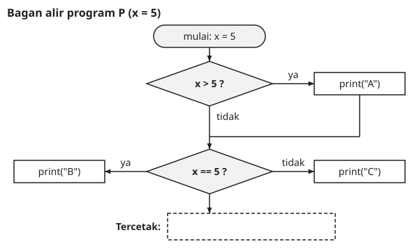

**Ingat dulu:** Tanpa melihat catatan: (a) tulis `JIKA ... MAKA ... LAINNYA` dari ingatan, lalu telusuri dua masukan; (b) hitung `17 // 5` dan `17 % 5`.

______



`[Gambar: bagan alir. Mulai dengan x = 5. Kotak keputusan "x > 5 ?": ya menuju print("A"), tidak lanjut ke kotak keputusan berikutnya. Kotak keputusan "x == 5 ?": ya menuju print("B"), tidak menuju print("C"). Di bawah ada kotak kosong "Tercetak". Lingkari jalur yang dilewati dan tulis hasilnya.]`

**Prediksi:** `if` berjalan hanya bila kondisinya benar. Pembanding: `==` sama dengan, `!=` tidak sama, `<` `>` `<=` `>=`. Program P:

```python
x = 5
if x > 5:
    print("A")
if x == 5:
    print("B")
else:
    print("C")
```

Apa yang dicetak? Tulis dulu: ______

Lalu telusuri pada bagan: tulis hasil tiap kondisi (benar atau salah). `x > 5`: ______ `x == 5`: ______

Mengapa `else` tidak berpasangan dengan `if x > 5`? ______

**Lengkapi:** Program yang mencetak "genap" atau "ganjil".

```python setengah-jadi
n = int(input("Bilangan? "))
if n ______ 2 == 0:
    print("genap")
______:
    print("ganjil")
```

Telusuri untuk masukan 9 dan 10. Apa yang tercetak? ______

**Susun:** Lima baris berikut diacak. Susun menjadi program yang mencetak harga tiket: Rp3.000, atau Rp1.500 bila umur kurang dari 12.

- **A.** `umur = int(input("Umur? "))`
- **B.** `tiket = 3000`
- **C.** `if umur < 12:`
- **D.** `    tiket = 1500` (menjorok di bawah `if`)
- **E.** `print(tiket)` (di kolom paling kiri)

Urutanku: ______ , ______ , ______ , ______ , ______

Mengapa `tiket = 3000` ditaruh sebelum `if`? ______

**Latihan:** (tanpa AI)

1. Tulis program yang membaca suhu dan mencetak `hangat` bila suhu 25 sampai 35 (pakai `and`), selain itu `lainnya`. Telusuri untuk 31, 20, dan 25. ______
2. Seorang murid menulis `if nilai >= 60:` lebih dulu, baru `elif nilai >= 75:`. Untuk nilai 80, apa yang tercetak dan mengapa? ______
3. Dengan dua kalimat, jelaskan beda dua `if` berurutan dan satu `if` yang disusul `elif`. ______

**Cek diri:**

- [ ] Aku bisa menulis `if`, `elif`, `else` dengan titik dua dan jorokan.
- [ ] Aku bisa menelusuri cabang yang dijalankan.
- [ ] Aku menguji di batas.

**Catatan cetak (untuk guru, tidak dicetak):** satu lembar A4, satu sampai dua halaman. Kunci ada di modul `SMP8-2-M4`, bagian "Contoh terselesaikan", "Catatan untuk guru", dan "Cek mandiri". Lembar tidak memuat kolom nama, kelas, tanggal, atau nilai.
