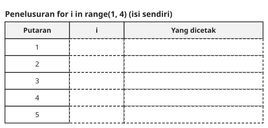

**Ingat dulu:** Tanpa melihat catatan: (a) apa yang berubah dan apa yang tetap pada tiap putaran perulangan yang memakai variabel `i`? (b) tulis padanan Python untuk `repeat (3)` berisi `say [Halo] for (1) seconds`.

______



`[Gambar: tabel tiga kolom (Putaran, i, Yang dicetak) dengan lima baris bernomor 1 sampai 5. Kolom i dan Yang dicetak kosong; pakai sebanyak baris yang diperlukan.]`

**Prediksi:** `range(1, 4)` menghasilkan 1, 2, 3: batas awal ikut, batas akhir tidak ikut. Program P:

```python
for i in range(1, 4):
    print(i, "x 3 =", i * 3)
```

Apa yang dicetak, berapa baris, dan berapa `i` pada tiap baris? Tulis dulu: ______

Lalu isi tabel pada gambar. Apa yang berubah tiap putaran dan apa yang tetap? ______

**Lengkapi:** Program yang menjumlahkan 1 sampai 5.

```python setengah-jadi
total = 0
for i in range(1, ______):
    total = total + ______
print(total)
```

Telusuri `total` sesudah tiap putaran: ______ Apa yang tercetak? ______

**Susun:** Enam baris berikut diacak. Susun menjadi program yang menghitung berapa minggu sampai tabungan Rp100 mencapai Rp130 bila tiap minggu bertambah Rp10.

- **A.** `saldo = 100`
- **B.** `minggu = 0`
- **C.** `while saldo < 130:`
- **D.** `    saldo = saldo + 10` (menjorok di bawah `while`)
- **E.** `    minggu = minggu + 1` (menjorok di bawah `while`)
- **F.** `print(minggu, saldo)` (di kolom paling kiri)

Urutanku: ______ , ______ , ______ , ______ , ______ , ______

Mengapa `print` tidak menjorok? ______

**Latihan:** (tanpa AI)

1. Ubah tabel perkalian P agar sampai `x 10`. Apa baris terakhir untuk `n` = 4? ______
2. Tulis program dengan `for` yang mencetak 2, 4, 6, 8, 10. Telusuri `i` dan hasilnya. ______
3. Program `angka = 1`, lalu `while angka <= 3:` dengan isi `print(angka)` saja tidak pernah berhenti. Mengapa, dan baris apa yang perlu ditambahkan? Jangan jalankan sebelum memprediksi. ______
4. Dengan dua kalimat, jelaskan kapan memilih `for` dan kapan memilih `while`. ______

**Cek diri:**

- [ ] Aku bisa menyebut batas awal dan akhir sebuah `range`.
- [ ] Aku bisa menelusuri `for` dan `while` dengan tabel.
- [ ] Aku bisa memilih `for` atau `while` untuk satu masalah.

**Catatan cetak (untuk guru, tidak dicetak):** satu lembar A4, satu sampai dua halaman. Kunci ada di modul `SMP8-2-M5`, bagian "Contoh terselesaikan", "Catatan untuk guru", dan "Cek mandiri". Lembar tidak memuat kolom nama, kelas, tanggal, atau nilai.
