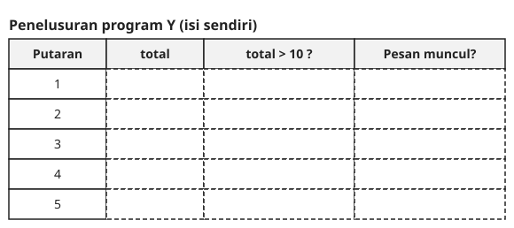

**Ingat dulu:** Tanpa melihat catatan: (a) terjemahkan ke Python `set [total] to (0)`, lalu `repeat (4)` berisi `change [total] by (3)`, lalu `say (total)`; (b) tulis padanan Python untuk `ask [7 + 5 = ?] and wait` lalu `if <(answer) = (12)> then`.

______



`[Gambar: tabel empat kolom (Putaran, total, total > 10 ?, Pesan muncul?) dengan lima baris bernomor 1 sampai 5. Tiga kolom terakhir kosong.]`

**Prediksi:** Program Scratch X dan Python Y dibuat sepasang.

```text
when green flag clicked
set [total] to (0)
repeat (5)
  change [total] by (3)
  if <(total) > (10)> then
    say [Lebih dari 10] for (1) seconds
```

```python
total = 0
for putaran in range(5):
    total = total + 3
    if total > 10:
        print("Lebih dari 10")
```

Pada putaran ke berapa pesan muncul? ______ Berapa kali pesan muncul di X dan di Y? ______

Isi tabel pada gambar untuk mencocokkan. Di X pesan hilang sesudah satu detik; apa yang terjadi pada pesan di Y? ______

**Lengkapi:** Terjemahkan `ask [Siapa namamu?] and wait`, lalu `say (join [Halo, ] (answer))`.

```python setengah-jadi
jawab = ______("Siapa namamu? ")
print("Halo,", ______)
```

Telusuri untuk masukan `Murid-01`. Apa yang tercetak? ______

**Susun:** Enam baris berikut diacak. Susun menjadi kuis tiga soal yang sama dan mencetak skor akhir.

- **A.** `skor = 0`
- **B.** `for soal in range(3):`
- **C.** `    jawab = int(input("2 + 2 = ? "))` (menjorok di bawah `for`)
- **D.** `    if jawab == 4:` (menjorok di bawah `for`)
- **E.** `        skor = skor + 1` (menjorok di bawah `if`)
- **F.** `print("Skor:", skor)` (di kolom paling kiri)

Urutanku: ______ , ______ , ______ , ______ , ______ , ______

Telusuri untuk jawaban 4, 5, 4. Skor akhir: ______

**Latihan:** (tanpa AI)

1. Terjemahkan: `set [x] to (1)`, lalu `repeat (3)` berisi `set [x] to ((x) * (2))`, lalu `say (x)`. Berapa yang tercetak? ______
2. Terjemahkan: `if <(suhu) > (30)> then say [Panas] else say [Sejuk]`, dengan `suhu` diisi 31 lebih dulu. ______
3. Seorang murid menulis `jawab = input("7 + 5 = ? ")` lalu `if jawab == 12:` tanpa `int`. Untuk masukan 12, apa yang tercetak dan mengapa? ______
4. Sebut satu keuntungan blok dan satu keuntungan teks menurut pengalamanmu. ______

**Cek diri:**

- [ ] Aku bisa menerjemahkan program Scratch kecil ke Python.
- [ ] Aku bisa menelusuri dua program dengan masukan yang sama.
- [ ] Aku ingat membungkus `input` dengan `int` bila akan dihitung.

**Catatan cetak (untuk guru, tidak dicetak):** satu lembar A4, satu sampai dua halaman. Kunci ada di modul `SMP8-2-M6`, bagian "Contoh terselesaikan", "Catatan untuk guru", dan "Cek mandiri". Lembar tidak memuat kolom nama, kelas, tanggal, atau nilai.
