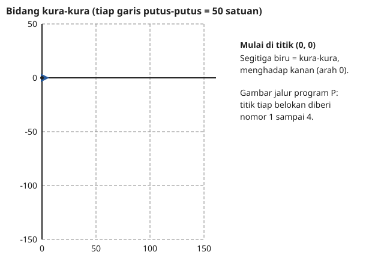

**Ingat dulu:** Tanpa melihat catatan: (a) tulis angka yang dihasilkan `range(1, 4)` dan `range(3)`; (b) tulis aturan sudut putar untuk bentuk beraturan `n` sisi, lalu hitung untuk `n` = 5.

______



`[Gambar: bidang koordinat dengan titik (0, 0) di kiri atas, sumbu x ke kanan sampai 150 dan sumbu y dari 50 ke atas sampai -150 ke bawah, garis putus-putus tiap 50 satuan. Segitiga biru di (0, 0) menunjukkan kura-kura menghadap kanan. Bidang kosong; gambarkan jalur program P dan beri nomor tiap belokan.]`

**Prediksi:** `turtle.Turtle()` membuat kura-kura yang mulai di (0, 0) menghadap kanan. Arah diukur dari kanan (0), dan `right` memutar searah jarum jam. Program P:

```python
import turtle

t = turtle.Turtle()
for i in range(4):
    t.forward(100)
    t.right(90)
turtle.done()
```

Bentuk apa yang tergambar? ______ Di mana kura-kura berhenti dan menghadap ke mana? ______

Telusuri, lalu gambar jalurnya pada bidang:

| putaran | posisi sesudah `forward` | arah sesudah `right` |
| --- | --- | --- |
| 1 | | |
| 2 | | |
| 3 | | |
| 4 | | |

**Lengkapi:** Spiral kotak: sisi awal 10, tiap putaran bertambah 10, dan belok 90 derajat.

```python setengah-jadi
import turtle

t = turtle.Turtle()
panjang = 10
for i in range(______):
    t.forward(panjang)
    t.right(______)
    panjang = panjang + ______
turtle.done()
```

Lengkapi untuk 20 sisi. Telusuri posisi sesudah empat putaran pertama: ______

**Susun:** Enam baris berikut diacak. Susun menjadi program yang menggambar segitiga sama sisi dengan sisi 100.

- **A.** `import turtle`
- **B.** `t = turtle.Turtle()`
- **C.** `for i in range(3):`
- **D.** `    t.forward(100)` (menjorok di bawah `for`)
- **E.** `    t.right(120)` (menjorok di bawah `for`)
- **F.** `turtle.done()` (di kolom paling kiri)

Urutanku: ______ , ______ , ______ , ______ , ______ , ______

Mengapa sudutnya 120, bukan 60? ______

**Latihan:** (tanpa AI)

1. Ubah segi enam menjadi segi delapan. Berapa derajat tiap belokan dan di mana kura-kura berhenti? ______
2. Seorang murid ingin segitiga tetapi menulis `for i in range(4):` dengan `forward(100)` dan `right(60)`. Mengapa gambarnya tidak tertutup? ______
3. Dengan dua kalimat, sebut satu hal yang sama dan satu hal yang beda antara blok pena Scratch dan kura-kura Python. ______

**Cek diri:**

- [ ] Aku bisa menggambar bentuk beraturan dengan `for`.
- [ ] Aku bisa menghitung sudut belokan 360 dibagi `n`.
- [ ] Aku bisa menelusuri posisi dan arah dengan tabel.

**Catatan cetak (untuk guru, tidak dicetak):** satu lembar A4, satu sampai dua halaman. Kunci ada di modul `SMP8-2-M7`, bagian "Catatan untuk guru" dan "Cek mandiri". Lembar tidak memuat kolom nama, kelas, tanggal, atau nilai.
