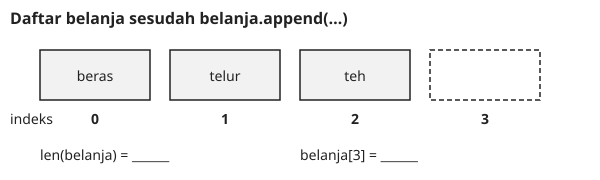

**Ingat dulu:** Tanpa melihat catatan: (a) hitung sudut belokan untuk segi lima dan segi delapan beraturan; (b) jelaskan mengapa `"7" + "2"` menghasilkan 72 dan bukan 9.

______



`[Gambar: empat kotak berurutan dengan indeks 0 sampai 3. Kotak 0, 1, 2 berisi beras, telur, teh. Kotak 3 kosong untuk diisi sesudah append. Di bawahnya dua isian: len(belanja) dan belanja[3].]`

**Prediksi:** Daftar menyimpan banyak nilai di bawah satu nama; isinya diambil dengan indeks yang mulai dari 0. Program P:

```python
belanja = ["beras", "telur", "teh"]
belanja.append("gula")
print(len(belanja))
print(belanja[0])
print(belanja[3])
for barang in belanja:
    print("-", barang)
```

Apa yang dicetak, baris demi baris? Tulis dulu: ______

Lalu isi gambar dan telusuri program. Mengapa `belanja[3]` ada isinya padahal awalnya hanya tiga barang? ______

**Lengkapi:** Hitung berapa harga yang lebih dari 3000.

```python setengah-jadi
harga = [3000, 5000, 2000, 7000]
banyak = 0
for h in harga:
    if h ______ 3000:
        banyak = banyak + ______
print("Mahal:", ______)
```

Telusuri `h` dan `banyak` tiap putaran: ______ Apa yang dicetak? ______

**Susun:** Lima baris berikut diacak. Susun menjadi program yang mencetak `2` lalu `pena`.

- **A.** `tas = []`
- **B.** `tas.append("pena")`
- **C.** `tas.append("buku")`
- **D.** `print(len(tas))`
- **E.** `print(tas[0])`

Urutanku: ______ , ______ , ______ , ______ , ______

Apa yang tercetak bila B dan C ditukar? ______

**Latihan:** (tanpa AI)

1. Ubah P agar mencetak isi terakhir dengan `len`, tanpa menulis angka 3 langsung. ______
2. Tulis program yang membaca empat angka ke daftar lalu mencetak jumlahnya. ______
3. `tas = ["pena", "buku", "penggaris", "pensil"]` lalu `print(tas[4])` berhenti dengan galat. Mengapa? ______
4. Dengan dua kalimat, sebut beda nomor urut Scratch dan indeks Python. ______

**Cek diri:**

- [ ] Aku bisa membuat daftar dan menambah isi ke ujungnya.
- [ ] Aku bisa mengambil isi dengan indeks yang benar.
- [ ] Aku bisa menelusuri `for` pada daftar dengan tabel.

**Catatan cetak (untuk guru, tidak dicetak):** satu lembar A4, satu sampai dua halaman. Kunci ada di modul `SMP8-2-M8`, bagian "Contoh terselesaikan", "Catatan untuk guru", dan "Cek mandiri". Lembar tidak memuat kolom nama, kelas, tanggal, atau nilai.
