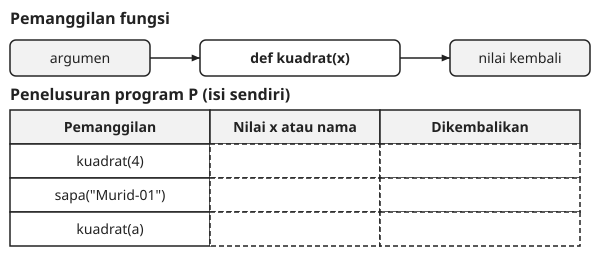

**Ingat dulu:** Tanpa melihat catatan: (a) tulis daftar `[4, 7, 1]` dan cetak jumlah isinya dengan `for`; (b) tulis `if` dan `else` yang mencetak `Lulus` bila `nilai >= 60`, selain itu `Ulang`.

______



`[Gambar: tiga kotak dihubungkan panah, yaitu argumen, def kuadrat(x), dan nilai kembali. Di bawahnya tabel tiga kolom (Pemanggilan, Nilai x atau nama, Dikembalikan) dengan tiga baris: kuadrat(4), sapa("Murid-01"), kuadrat(a). Dua kolom terakhir kosong.]`

**Prediksi:** `def` memberi nama pada beberapa baris, parameter adalah masukan fungsi, `return` mengirim hasil kembali, dan nilai yang kamu kirim saat memanggil disebut argumen. Program P:

```python
def kuadrat(x):
    return x * x

def sapa(nama):
    print("Halo,", nama)

a = kuadrat(4)
sapa("Murid-01")
print(a)
print(kuadrat(a))
```

Apa yang dicetak, baris demi baris? Berapa nilai `a`? Tulis dulu: ______

Lalu isi tabel pada gambar. Apakah `def` saja menjalankan isinya? ______

**Lengkapi:** Fungsi untuk umur tahun depan.

```python setengah-jadi
def tahun_depan(umur):
    return ______

def salam(nama, umur):
    print("Halo,", ______, "- tahun depan kamu", tahun_depan(______))

salam("Murid-02", 12)
```

Apa yang tercetak? ______

**Susun:** Empat baris berikut diacak. Susun menjadi program yang mencetak `10`.

- **A.** `def ganda(n):`
- **B.** `    return n * 2` (menjorok di bawah `def`)
- **C.** `hasil = ganda(5)`
- **D.** `print(hasil)`

Urutanku: ______ , ______ , ______ , ______

Mengapa `def` harus ada sebelum pemanggilan? ______

**Latihan:** (tanpa AI)

1. Ubah `kuadrat` menjadi `kubik` (tiga kali kali). Berapa `kubik(3)`? ______
2. Tulis fungsi `lebih_besar(a, b)` yang mengembalikan angka yang lebih besar, lalu panggil dengan 4 dan 9. ______
3. Dengan dua kalimat, sebut beda parameter dan argumen. ______

**Cek diri:**

- [ ] Aku bisa menulis fungsi dengan parameter dan `return`.
- [ ] Aku bisa menelusuri pemanggilan fungsi dengan tabel.
- [ ] Aku bisa menjelaskan beda `print` dan `return`.

**Catatan cetak (untuk guru, tidak dicetak):** satu lembar A4, satu sampai dua halaman. Kunci ada di modul `SMP8-2-M9`, bagian "Contoh terselesaikan", "Catatan untuk guru", dan "Cek mandiri". Lembar tidak memuat kolom nama, kelas, tanggal, atau nilai.
