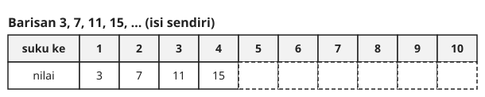

**Ingat dulu:** Tanpa melihat catatan: (a) jelaskan abstraksi dengan satu contoh blok; (b) apa beda pola dan generalisasi? (c) sebut lima langkah mencari kesalahan dari menjalankan sampai uji ulang.

______



`[Gambar: tabel dua baris. Baris pertama "suku ke" berisi 1 sampai 10. Baris kedua "nilai" terisi 3, 7, 11, 15 pada suku 1 sampai 4; suku 5 sampai 10 kosong.]`

**Prediksi:** Barisan: 3, 7, 11, 15, ... Setiap bilangan disebut suku, dan suku pertama adalah 3. Berapa suku ke-10? Tulis dulu tebakanmu dan alasannya: ______

Lalu lengkapi tabel pada gambar dengan tangan. Apa yang tetap pada setiap langkah, dan bagaimana kamu bisa mendapat suku ke-10 tanpa menulis semua suku? ______

**Lengkapi:** Persegi dari batang korek api disusun berjajar: satu persegi memakai 4 batang, dua persegi 7 batang, tiga persegi 10 batang. Berapa batang untuk 10 persegi?

```text setengah-jadi
Pahami: yang ditanya adalah banyak ______ untuk 10 persegi.
Kasus kecil: 1 persegi 4 batang, 2 persegi 7, 3 persegi 10.
Pola: tiap persegi baru menambah ______ batang.
Aturan: batang = 4 + ______ x (n - 1).
Untuk n = 10: ______ batang.
Tinjau ulang: gambar 10 persegi lalu hitung garis ______ dan garis ______ secara terpisah.
```

**Susun:** Enam langkah pemecahan soal berikut diacak. Susun menjadi urutan yang masuk akal.

- **A.** Tulis jawaban beserta alasannya.
- **B.** Baca soal dan tulis apa yang ditanya.
- **C.** Hitung kasus kecil dan catat dalam tabel.
- **D.** Pakai aturan untuk kasus yang besar.
- **E.** Tinjau ulang dengan cara yang berbeda.
- **F.** Cari pola dan tulis aturan umum.

Urutanku: ______ , ______ , ______ , ______ , ______ , ______

Mengapa langkah tinjau ulang bukan yang pertama? ______

**Latihan:** (tanpa AI)

1. Ubah soal jabat tangan menjadi 9 murid (setiap dua murid berjabat tangan tepat sekali). Hitung dengan dua cara dan cocokkan. ______
2. Dari 2, 4, 8, seorang murid menulis suku ke-5 adalah 14, dan temannya menulis 32. Tulis aturan yang dipakai masing-masing. Apakah tiga suku cukup untuk memastikan pola? ______
3. Mengapa menghitung ulang dengan cara yang sama kurang meyakinkan dibanding cara yang berbeda? ______

**Cek diri:**

- [ ] Aku bisa mencoba kasus kecil dan membuat tabel.
- [ ] Aku bisa menulis aturan umum dari pola.
- [ ] Aku bisa meninjau ulang dengan cara yang berbeda.

**Catatan cetak (untuk guru, tidak dicetak):** satu lembar A4, satu sampai dua halaman. Kunci ada di modul `SMP9-1-M1`, bagian "Contoh terselesaikan", "Catatan untuk guru", dan "Cek mandiri". Lembar tidak memuat kolom nama, kelas, tanggal, atau nilai.
