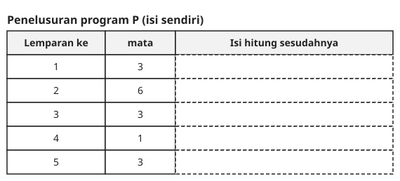

**Ingat dulu:** Tanpa melihat catatan: (a) jelaskan mengapa sebuah simulasi perlu menuliskan asumsinya; (b) tulis fungsi `cari(daftar, x)` yang mengembalikan indeks pertama atau -1; (c) sebut tiga hal yang dibandingkan dari dua solusi untuk satu soal.

______



`[Gambar: tabel tiga kolom (Lemparan ke, mata, Isi hitung sesudahnya) dengan lima baris. Kolom mata terisi 3, 6, 3, 1, 3. Kolom isi hitung kosong; tulis isi kamus sesudah tiap lemparan.]`

**Prediksi:** Simulasi meniru kejadian dengan program. Program P menghitung hasil lima lemparan dadu rekaan:

```python
lemparan = [3, 6, 3, 1, 3]
hitung = {}
for mata in lemparan:
    hitung[mata] = hitung.get(mata, 0) + 1
print(hitung)
```

Apa yang tercetak? Tulis dulu: ______

Lalu isi tabel pada gambar. Mata apa yang tidak muncul di kamus, dan apa artinya? ______

**Lengkapi:** Lempar koin 20 kali.

```python setengah-jadi
import random

random.seed(1)
hitung = {"gambar": 0, "angka": 0}
for i in range(______):
    sisi = random.choice(["gambar", "angka"])
    hitung[______] = hitung[sisi] + 1
print(hitung["gambar"] + hitung["angka"])
```

Apa yang tercetak? ______

**Susun:** Lima langkah membuat simulasi berikut diacak. Susun menjadi urutan yang masuk akal.

- **A.** Tulis soal dan asumsi.
- **B.** Tulis program yang mengulang percobaan dan menghitung hasil.
- **C.** Jalankan dan catat hasil.
- **D.** Ulangi dengan percobaan lebih banyak.
- **E.** Tulis kesimpulan beserta batasnya.

Urutanku: ______ , ______ , ______ , ______ , ______

Mengapa asumsi ditulis sebelum program? ______

**Latihan:** (tanpa AI)

1. Simulasikan lempar dua dadu 100 kali dan hitung berapa kali jumlahnya 7. Tulis dua asumsimu dan satu kalimat kesimpulan beserta batasnya. ______
2. Jalankan `random.seed(5)` lalu `random.randint(1, 6)` dua kali pada dua jalan terpisah. Apa yang sama, dan mengapa? ______
3. Mengapa simulasi perlu menuliskan asumsinya? ______

**Cek diri:**

- [ ] Aku bisa menulis simulasi lempar dadu dengan kamus penghitung.
- [ ] Aku bisa menulis asumsi dan batas simulasi.
- [ ] Aku bisa menjelaskan mengapa banyak percobaan lebih meyakinkan.

**Catatan cetak (untuk guru, tidak dicetak):** satu lembar A4, satu sampai dua halaman. Kunci ada di modul `SMP9-1-M10`, bagian "Contoh terselesaikan", "Catatan untuk guru", dan "Cek mandiri". Lembar tidak memuat kolom nama, kelas, tanggal, atau nilai.
