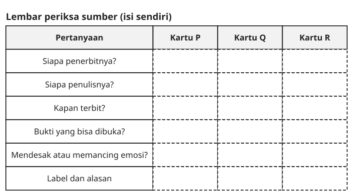

**Ingat dulu:** Tanpa melihat catatan: (a) sebut tiga pertanyaan untuk memeriksa kredibilitas sebuah sumber; (b) sebut dua cara sebuah grafik bisa menyesatkan pembacanya; (c) mengapa kesimpulan dari simulasi hanya sah sebatas asumsinya?

______



`[Gambar: tabel dengan enam baris pertanyaan (Siapa penerbitnya? Siapa penulisnya? Kapan terbit? Bukti yang bisa dibuka? Mendesak atau memancing emosi? Label dan alasan) dan tiga kolom kosong Kartu P, Kartu Q, Kartu R.]`

**Prediksi:** Tiga kartu rekaan:

- **Kartu P.** Pesan berantai: "AWAS! Besok sekolah se-kota LIBUR karena banjir. Sebarkan ke semua grup SEKARANG!" Tanpa nama pengirim asli, tanpa tanggal, tanpa tautan.
- **Kartu Q.** Pengumuman di situs resmi Dinas Contoh, tanggal 2026-10-05: "Ujian semester ganjil dimulai 1 Desember 2026." Ada nomor kontak dinas.
- **Kartu R.** Artikel di situs "Berita Kilat Contoh" (tanpa halaman "tentang kami", penulis "Admin"): foto sungai berisi ikan sangat besar dengan judul "Gempar! Ikan Raksasa Muncul Kemarin!". Foto yang sama ternyata dimuat di arsip sebuah situs lain pada tahun 2019.

Tulis untuk tiap kartu satu label (*fakta yang bisa diperiksa*, *belum bisa dipastikan*, atau *menyesatkan*) dan satu alasan: ______

Lalu isi lembar periksa sumber pada gambar dan cocokkan dengan labelmu.

**Lengkapi:** Kartu S: pesan berantai "Jalan Contoh ditutup besok! Cepat sebarkan!", tanpa penerbit, tanpa tanggal, tanpa tautan.

```text setengah-jadi
Penerbit: ______
Tanggal: ______
Bukti yang bisa dibuka: ______
Mendesak atau memancing emosi: ______
Tindakan: ______ (bagikan, periksa dulu, atau jangan bagikan) karena ______
Cara memeriksa: cari pengumuman di ______
```

**Susun:** Lima langkah saat menerima pesan berikut diacak. Susun menjadi urutan yang masuk akal.

- **A.** Baca seluruh pesan, bukan hanya judulnya.
- **B.** Periksa penerbit dan penulisnya.
- **C.** Periksa tanggalnya dan apakah isinya pernah muncul sebelumnya.
- **D.** Cari bukti yang bisa dibuka, dan bandingkan dengan sumber resmi.
- **E.** Putuskan: bagikan, periksa dulu, atau jangan bagikan.

Urutanku: ______ , ______ , ______ , ______ , ______

Mengapa E paling akhir? ______

**Latihan:** (tanpa AI)

1. Ubah Kartu P menjadi pengumuman yang layak dipercaya. Apa yang kamu tambahkan? ______
2. Kartu T: tangkapan layar tanpa sumber berbunyi "Kota Contoh melarang semua ponsel!". Tulis empat pertanyaan yang kamu ajukan. ______
3. Mengapa "banyak yang membagikan" bukan bukti kebenaran? ______

**Cek diri:**

- [ ] Aku bisa memakai lembar periksa sumber.
- [ ] Aku bisa membedakan fakta, opini, dan hoaks.
- [ ] Aku tahu mencari informasi publik di sumber resmi.

**Catatan cetak (untuk guru, tidak dicetak):** satu lembar A4, satu sampai dua halaman. Kunci ada di modul `SMP9-1-M11`, bagian "Contoh terselesaikan", "Catatan untuk guru", dan "Cek mandiri". Lembar tidak memuat kolom nama, kelas, tanggal, atau nilai.
