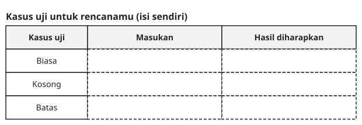

**Ingat dulu:** Tanpa melihat catatan: (a) tulis bagian rencana kerja untuk proyek yang belum kamu buat: tujuan, bagian kecil, tiga kasus uji, dan pembagian kerja; (b) sebut apa yang kamu periksa sebelum memakai bahan orang lain di proyekmu.

______

`[Gambar: tabel tiga kolom (Kasus uji, Masukan, Hasil diharapkan) dengan tiga baris bernama Biasa, Kosong, dan Batas. Kolom Masukan dan Hasil diharapkan kosong.]`

**Prediksi:** Proyek akhir dikerjakan di semester depan selama tujuh pekan untuk satu persoalan di sekitar kita. Dua rencana rekaan untuk persoalan sampah plastik:

- **Rencana X.** "Kami akan membuat aplikasi canggih yang menyelesaikan semua masalah sampah di kota."
- **Rencana Y.** "Kami membuat program Python yang membaca data rekaan sampah plastik per kelas dari berkas dan mencetak grafik batang teks. Pengguna: petugas kebersihan kelas. Kami menguji dengan tiga berkas data."

Rencana mana yang dapat selesai dan diuji dalam tujuh pekan? Tulis satu alasan untuk tiap rencana: ______

**Lengkapi:** Rencana tim untuk persoalan yang kamu pilih sendiri, misalnya data suhu rekaan sekolah atau daftar buku perpustakaan rekaan.

| Bagian rencana | Isi timmu |
| --- | --- |
| Persoalan dan pengguna | ______ |
| Tujuan satu kalimat | ______ |
| Masukan, proses, keluaran | ______ |
| Bagian kecil (3 sampai 4) | ______ |
| Pembagian kerja | ______ |
| Tidak akan dikerjakan | ______ |
| Rencana cadangan | ______ |
| Bahan orang lain dan izinnya | ______ |
| Data pribadi | ______ |

**Latihan:** (tanpa AI)

1. Tulis tiga kelemahan Rencana X, lalu tulis ulang menjadi rencana yang kecil dan bisa diuji. ______
2. Tulis tiga kasus uji untuk rencanamu pada tabel di gambar: masukan dan hasil diharapkan, tiap kasus satu baris.
3. Presentasikan rencanamu dalam satu menit. Sebut juga satu hal yang tidak akan dikerjakan timmu, dan alasannya. ______

**Cek diri:**

- [ ] Rencana timku punya tujuan satu kalimat dan bagian kecil.
- [ ] Rencana timku punya tiga kasus uji dan rencana cadangan.
- [ ] Rencana timku tidak memakai data pribadi nyata.

**Catatan cetak (untuk guru, tidak dicetak):** satu lembar A4, satu sampai dua halaman; bagian "Susun" dilewati karena minggu perencanaan memakai tabel rencana tim. Kunci ada di modul `SMP9-1-M12`, bagian "Contoh terselesaikan", "Catatan untuk guru", dan "Cek mandiri". Lembar tidak memuat kolom nama, kelas, tanggal, atau nilai.
