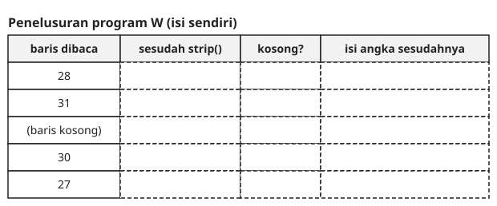

**Ingat dulu:** Tanpa melihat catatan: (a) sebut jenis galat bila berkas tidak ditemukan dan dua penyebabnya; (b) tulis tiga kasus uji untuk program yang membaca data kecil: biasa, kosong, dan di batas.

______



`[Gambar: tabel empat kolom (baris dibaca, sesudah strip(), kosong?, isi angka sesudahnya) dengan lima baris: 28, 31, baris kosong, 30, 27. Tiga kolom terakhir kosong.]`

**Prediksi:** Berkas `suhu.txt` berisi suhu rekaan, satu angka satu baris, dengan satu baris kosong di tengah: `28`, `31`, (baris kosong), `30`, `27`. Program W:

```python
def baca_angka(nama):
    angka = []
    with open(nama, encoding="utf-8") as berkas:
        for baris in berkas:
            baris = baris.strip()
            if baris != "":
                angka.append(int(baris))
    return angka

def ringkas(angka):
    if len(angka) == 0:
        return "data kosong"
    rata = sum(angka) / len(angka)
    return "rata-rata " + str(rata) + ", terbesar " + str(max(angka))

print(ringkas(baca_angka("suhu.txt")))
```

Apa yang tercetak? Isi `angka` ada berapa? Tulis dulu: ______

Lalu isi tabel pada gambar.

**Lengkapi:** Rencana kerja pengolah datamu sendiri.

| Bagian rencana | Isimu |
| --- | --- |
| Tujuan satu kalimat | ______ |
| Bagian kecil (3 sampai 4) | ______ |
| Isi berkas data rekaanmu | ______ |
| Tiga kasus uji (biasa, kosong, batas) | ______ |
| Asal dan lisensi data | ______ |
| Data pribadi | ______ |

**Latihan:** (tanpa AI)

1. Tulis program yang membaca `data.txt` buatanmu sendiri, satu angka satu baris, dan mencetak jumlah, rata-rata, dan nilai terbesar, dengan fungsi `baca_angka` dan `ringkas`. ______
2. Satu berkas berisi baris `abc` di tengah angka, dan program berhenti. Tulis catatan penyebab: gejala, penyebab, perbaikan, aturan umum. ______
3. Jelaskan programmu lisan dalam satu menit: tujuan, bagian kecil, satu hal yang kamu temukan, dan satu galat yang kamu perbaiki.

**Cek diri:**

- [ ] Aku punya rencana kerja sebelum membuat.
- [ ] Aku menguji dengan tiga kasus, termasuk berkas kosong.
- [ ] Aku bisa menjelaskan programku dalam satu menit.

**Catatan cetak (untuk guru, tidak dicetak):** satu lembar A4, satu sampai dua halaman; bagian "Susun" dilewati karena minggu proyek memakai rencana kerja. Kunci ada di modul `SMP9-1-M13`, bagian "Contoh terselesaikan", "Catatan untuk guru", dan "Cek mandiri". Lembar tidak memuat kolom nama, kelas, tanggal, atau nilai.
