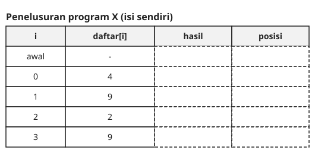

**Ingat dulu:** Tutup semua catatan dan modul. Jawab dulu, baru periksa kunci di modul. (a) Untuk barisan 5, 8, 11, 14, ... tulis aturannya dan hitung suku ke-20. (b) Tulis fungsi yang mengembalikan rata-rata sebuah daftar dan telusuri untuk `[2, 4, 9]`. (c) Sebut beda fakta, opini, dan hoaks.

______



`[Gambar: tabel empat kolom (i, daftar[i], hasil, posisi) dengan satu baris "awal" dan empat baris i = 0 sampai 3 dengan daftar[i] 4, 9, 2, 9. Kolom hasil dan posisi kosong.]`

**Prediksi:** Tulis prediksimu sebelum menelusuri. Program X:

```python
def posisi_terbesar(daftar):
    hasil = daftar[0]
    posisi = 0
    for i in range(len(daftar)):
        if daftar[i] > hasil:
            hasil = daftar[i]
            posisi = i
    return posisi

print(posisi_terbesar([4, 9, 2, 9]))
```

Apa yang tercetak? ______

Lalu isi tabel pada gambar: `hasil` dan `posisi` per putaran.

**Lengkapi:** Fungsi rata-rata dengan pengaman daftar kosong.

```python setengah-jadi
def rata_rata(daftar):
    if len(daftar) == ______:
        return 0
    total = 0
    for n in daftar:
        total = total + ______
    return total / ______

print(rata_rata([6, 8, 10]))
print(rata_rata([]))
```

Telusuri `rata_rata([6, 8, 10])`. Apa yang tercetak untuk dua pemanggilan? ______

**Latihan:** Kerjakan tanpa catatan dan tanpa AI. Periksa dengan kunci hanya sesudah selesai.

1. Tulis fungsi `ringkas(daftar)` yang mengembalikan teks berisi rata-rata dan nilai terbesar, dan `"data kosong"` untuk daftar kosong. Ujikan pada `[3, 8, 5, 9, 5]`. ______
2. Program: `def rata(daftar):` berisi `total = 0`, `for n in daftar:` dengan `total = total + n`, dan `return total / len(daftar)`; lalu `print(rata([]))`. Tulis jenis galat, penyebab, dan perbaikan. ______
3. Tulis tiga kasus uji untuk `cari(daftar, x)`: ada di awal, ada di akhir, dan tidak ada, beserta hasil diharapkan. ______

**Cek diri:**

- [ ] Aku menjawab sebelum melihat kunci.
- [ ] Aku menandai soal yang salah dan menyebut sebabnya.
- [ ] Aku menulis satu hal yang akan kulatih ulang.

**Catatan cetak (untuk guru, tidak dicetak):** satu lembar A4, satu sampai dua halaman; bagian "Susun" dilewati karena minggu ini berisi kuis mengingat. Kunci ada di modul `SMP9-1-M14`, bagian "Catatan untuk guru" dan "Cek mandiri". Lembar tidak memuat kolom nama, kelas, tanggal, atau nilai.
