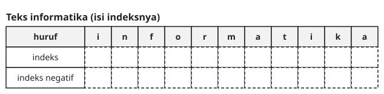

**Ingat dulu:** Tanpa melihat catatan: (a) tulis dua cara menggabungkan teks dan angka dalam `print`, dan jelaskan mengapa `"Umur: " + 12` menimbulkan `TypeError`; (b) berapa nomor indeks isi pertama sebuah daftar Python?

______



`[Gambar: sebelas kotak huruf i, n, f, o, r, m, a, t, i, k, a. Di bawahnya dua baris kosong: "indeks" dan "indeks negatif". Tulis nomor indeks tiap huruf, dihitung dari kiri dan dari kanan.]`

**Prediksi:** Teks (*string*) adalah urutan huruf. Indeks dimulai dari 0; indeks -1 berarti huruf terakhir; spasi juga dihitung. Program P:

```python
kalimat = "  Belajar Python itu seru  "
bersih = kalimat.strip()
print(len(kalimat), len(bersih))
print(bersih[0], bersih[-1])
print(bersih.upper())
kata = bersih.split()
print(len(kata), kata[1])
```

Apa yang tercetak pada empat baris keluaran? Tulis dulu: ______

Lalu hitung panjang `bersih` huruf demi huruf. Mengapa dua angka pada baris pertama berbeda? ______

**Lengkapi:** Program yang menyusun huruf pertama tiap kata menjadi singkatan.

```python setengah-jadi
kalimat = "Belajar Python itu seru"
inisial = ""
for kata in kalimat.______():
    inisial = inisial + kata[______]
print(______)
```

Isi `inisial` sesudah tiap putaran: ______

**Susun:** Empat baris berikut diacak. Susun menjadi program yang mencetak jumlah kata sebuah kalimat.

- **A.** `kalimat = "Ibu pergi ke pasar"`
- **B.** `kata = kalimat.split()`
- **C.** `jumlah = len(kata)`
- **D.** `print("Jumlah kata:", jumlah)`

Urutanku: ______ , ______ , ______ , ______

Mengapa C tidak boleh sebelum B? ______

**Latihan:** (tanpa AI)

1. Tulis program yang membaca satu kata dengan `input`, lalu mencetak panjangnya, huruf pertamanya, dan huruf terakhirnya. Telusuri untuk `informatika`. ______
2. Untuk `kata = "informatika"`, apa yang terjadi pada `print(kata[11])` dan pada `kata[0] = "I"`? Tulis jenis galat dan sebabnya. ______
3. Sesudah `kalimat.upper()` tanpa menyimpan hasilnya, mengapa `kalimat` tidak berubah? ______

**Cek diri:**

- [ ] Aku bisa memakai indeks dan irisan pada teks.
- [ ] Aku bisa memecah kalimat dan memprosesnya.
- [ ] Aku bisa menjelaskan mengapa teks tidak bisa diubah per huruf.

**Catatan cetak (untuk guru, tidak dicetak):** satu lembar A4, satu sampai dua halaman. Kunci ada di modul `SMP9-1-M2`, bagian "Contoh terselesaikan", "Catatan untuk guru", dan "Cek mandiri". Lembar tidak memuat kolom nama, kelas, tanggal, atau nilai.
