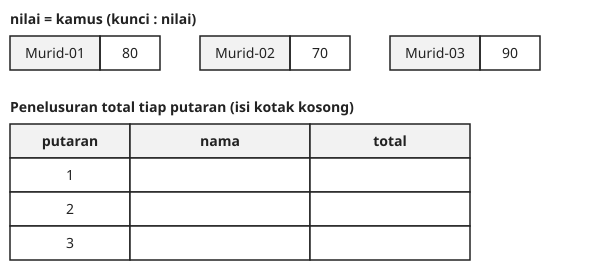

**Ingat dulu:** Tanpa melihat modul:

1. Tulis `if` dan `else` yang mencetak `"lulus"` bila `nilai` paling sedikit 60, selain itu `"ulang"`. ______
2. Sebut langkah pertama dan langkah terakhir memecahkan masalah. ______



`[Gambar: kamus nilai berisi tiga pasangan kunci dan nilai: Murid-01 80, Murid-02 70, Murid-03 90. Di bawahnya tabel penelusuran dengan kolom putaran, nama, dan total; tiga baris putaran; kolom nama dan total masih kosong untuk bagian Lengkapi.]`

**Prediksi:** Program P:

```python
kamus = {"buku": "book", "meja": "table", "kursi": "chair"}
print(kamus["meja"])
kamus["pensil"] = "pencil"
kamus["buku"] = "books"
print(len(kamus))
print("kursi" in kamus, "lampu" in kamus)
print(kamus.get("lampu", "belum ada"))
```

Empat baris keluaran yang tercetak: ______ / ______ / ______ / ______

Isi kamus sesudah baris 3: ______ Sesudah baris 4: ______

**Lengkapi:** Kamus nilai tiga murid dijumlahkan dan dirata-ratakan. Isi bagian kosong, lalu isi tabel penelusuran pada gambar.

```python setengah-jadi
nilai = {"Murid-01": 80, "Murid-02": 70, "Murid-03": 90}
total = 0
for nama in ____:
    total = total + nilai[____]
print(total, total / ____)
```

Yang tercetak: ______

**Susun:** Empat baris berikut diacak. Susun menjadi kamus terjemahan kecil yang menjawab kata yang dicari.

- **A.** `kamus = {"buku": "book", "meja": "table"}`
- **B.** `cari = input("Kata? ")`
- **C.** `jawab = kamus.get(cari, "belum ada")`
- **D.** `print(jawab)`

Urutanku: ______ , ______ , ______ , ______ Mengapa B harus sebelum C? ______

**Latihan:**

1. Pada P, tambahkan `"lampu": "lamp"`, lalu cetak `kamus["lampu"]`. Isi kamus akhirnya: ______
2. Untuk `kamus` pada P, apa yang tercetak oleh `print(kamus.get("lampu"))`, dan apa bedanya dengan `print(kamus["lampu"])`? ______
3. Dengan dua kalimat, jelaskan kapan kamu memilih daftar dan kapan kamus. ______

**Cek diri:**

- [ ] Aku bisa membuat dan membaca kamus.
- [ ] Aku bisa menambah dan memeriksa pasangan.
- [ ] Aku bisa menjelaskan beda daftar dan kamus.

**Catatan cetak (untuk guru, tidak dicetak):** satu lembar A4, satu sampai dua halaman. Kunci ada di modul `SMP9-1-M3`, bagian "Contoh terselesaikan", "Catatan untuk guru" (kunci), dan "Cek mandiri". Lembar tidak memuat kolom nama, kelas, tanggal, atau nilai.
