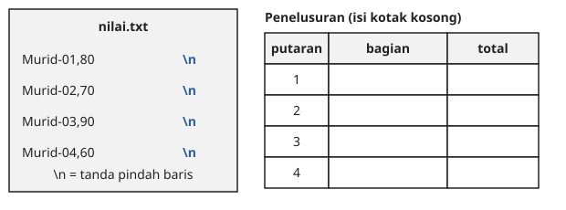

**Ingat dulu:** Tanpa melihat modul:

1. Pecah `"Murid-01,80"` menjadi dua bagian dan ubah bagian kedua menjadi bilangan. ______
2. Pada sebuah tabel, apa itu baris, kolom, dan sel? ______

Berkas `nilai.txt` berisi data sintetis, satu baris satu murid, nama dan nilai dipisah koma.



`[Gambar: kotak berkas nilai.txt dengan empat baris: Murid-01,80; Murid-02,70; Murid-03,90; Murid-04,60. Tiap baris berakhir tanda \n (pindah baris). Di sebelah kanan tabel penelusuran dengan kolom putaran, bagian, dan total; empat baris putaran masih kosong untuk diisi.]`

**Prediksi:** Program P:

```python
total = 0
with open("nilai.txt", encoding="utf-8") as berkas:
    for baris in berkas:
        bagian = baris.strip().split(",")
        print(bagian[0], bagian[1])
        total = total + int(bagian[1])
print("Total:", total)
```

Yang tercetak: ______ Nilai `total` sesudah putaran kedua: ______

Isi tabel penelusuran pada gambar (putaran, `bagian`, `total`). Mengapa `strip()` dipakai sebelum `split(",")`? ______

**Lengkapi:** Menghitung berapa murid bernilai paling sedikit 75. Isi bagian kosong.

```python setengah-jadi
lulus = 0
with open("nilai.txt", encoding="utf-8") as berkas:
    for baris in berkas:
        bagian = baris.____().split(",")
        if int(bagian[____]) >= 75:
            lulus = lulus + ____
print("Lulus:", lulus)
```

Telusuri `lulus` tiap putaran. Yang tercetak: ______

**Susun:** Enam baris berikut diacak. Susun menjadi program yang mencetak total semua nilai di `nilai.txt`.

- **A.** `total = 0`
- **B.** `with open("nilai.txt", encoding="utf-8") as berkas:`
- **C.** `for baris in berkas:` (menjorok di bawah `with`)
- **D.** `bagian = baris.strip().split(",")` (menjorok di bawah `for`)
- **E.** `total = total + int(bagian[1])` (menjorok di bawah `for`)
- **F.** `print("Total:", total)` (di kolom paling kiri)

Urutanku: ______ , ______ , ______ , ______ , ______ , ______ Mengapa A harus sebelum B? ______

**Latihan:**

1. Ubah P agar mencetak rata-rata, yaitu total dibagi banyak murid. Hasilnya: ______
2. Hapus `.strip()` dari P lalu jalankan. Apa yang berubah pada keluaran, dan mengapa `int(bagian[1])` tetap berhasil? ______ Lalu ubah nama berkas menjadi `nilaii.txt`; pesan galatnya: ______
3. Dengan dua kalimat, jelaskan mengapa `with` dipakai untuk membuka berkas. ______

**Cek diri:**

- [ ] Aku bisa membaca berkas teks per baris.
- [ ] Aku bisa memecah baris dan mengubah angkanya.
- [ ] Aku bisa menjelaskan `FileNotFoundError`.

**Catatan cetak (untuk guru, tidak dicetak):** satu lembar A4, satu sampai dua halaman. Kunci ada di modul `SMP9-1-M4`, bagian "Contoh terselesaikan", "Catatan untuk guru" (kunci), dan "Cek mandiri". Lembar tidak memuat kolom nama, kelas, tanggal, atau nilai.
