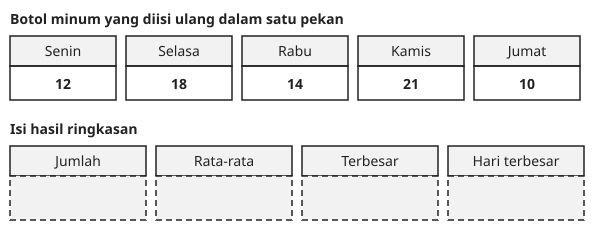

**Ingat dulu:** Tanpa melihat modul:

1. Dari lima angka 4, 6, 5, 9, 6, hitung rata-rata dan nilai terbesar. ______
2. Sebut satu hal yang tidak bisa dipastikan dari rata-rata. ______
3. Jelaskan beda `kamus.get(k)` dan `kamus[k]` untuk kunci yang tidak ada. ______



`[Gambar: lima kotak berisi data botol minum yang diisi ulang dalam satu pekan: Senin 12, Selasa 18, Rabu 14, Kamis 21, Jumat 10. Di bawahnya tiga kotak kosong berlabel Jumlah, Rata-rata, dan Terbesar, dan satu kotak kosong berlabel Hari terbesar.]`

**Prediksi:** Program P memakai data pada gambar:

```python
botol = {"Senin": 12, "Selasa": 18, "Rabu": 14, "Kamis": 21, "Jumat": 10}
jumlah = sum(botol.values())
rata = jumlah / len(botol)
terbesar = max(botol.values())
print(jumlah, rata, terbesar)
```

Hitung dengan tangan lebih dulu dan isi kotak pada gambar. Yang tercetak: ______ Apakah rata-rata ada di antara lima data? ______

**Lengkapi:** Ringkasan nilai ulangan `[70, 80, 90, 60]`. Isi bagian kosong.

```python setengah-jadi
nilai = [70, 80, 90, 60]
jumlah = ____(nilai)
rata = jumlah / ____(nilai)
print("Jumlah:", jumlah)
print("Rata-rata:", ____)
print("Terbesar:", ____(nilai))
```

**Susun:** Lima langkah meringkas data berikut diacak. Susun menjadi urutan yang masuk akal.

- **A.** Tulis pertanyaan yang ingin dijawab.
- **B.** Tulis data ke dalam program atau lembar kerja.
- **C.** Hitung jumlah, rata-rata, dan nilai terbesar.
- **D.** Cocokkan hasil dua cara.
- **E.** Tulis ringkasan dengan satuan dan batasnya.

Urutanku: ______ , ______ , ______ , ______ , ______ Mengapa D harus sebelum E? ______

**Latihan:**

1. Ubah Jumat menjadi 40. Hitung ulang jumlah, rata-rata, dan nilai terbesar, dan sebut hari terbesarnya. ______
2. Untuk `[10, 10, 10, 10, 70]`, hitung rata-rata dan nilai terbesar. Apa yang rata-rata tidak ceritakan? ______
3. Mengapa dua cara menghitung lebih meyakinkan daripada satu cara saja? ______

**Cek diri:**

- [ ] Aku bisa menghitung ringkasan data dengan program.
- [ ] Aku bisa mencocokkannya dengan lembar kerja atau hitungan tangan.
- [ ] Aku bisa menyebut batas dari rata-rata.

**Catatan cetak (untuk guru, tidak dicetak):** satu lembar A4, satu sampai dua halaman. Kunci ada di modul `SMP9-1-M5`, bagian "Contoh terselesaikan", "Catatan untuk guru" (kunci), dan "Cek mandiri". Lembar tidak memuat kolom nama, kelas, tanggal, atau nilai.
