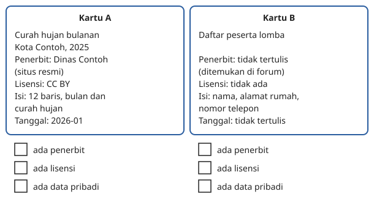

**Ingat dulu:** Tanpa melihat modul:

1. Beri satu contoh data pribadi yang tidak boleh ditempel ke layanan AI, dan alasannya. ______
2. Sebut satu hal yang tidak bisa dipastikan dari rata-rata. ______



`[Gambar: dua kartu data rekaan berdampingan. Kartu A: Curah hujan bulanan Kota Contoh, 2025; penerbit Dinas Contoh (situs resmi); lisensi CC BY; isi 12 baris bulan dan curah hujan; tanggal 2026-01. Kartu B: Daftar peserta lomba; penerbit tidak tertulis (ditemukan di forum); lisensi tidak ada; isi nama, alamat rumah, nomor telepon; tanggal tidak tertulis. Di bawah tiap kartu tiga kotak centang kosong: ada penerbit, ada lisensi, ada data pribadi.]`

**Prediksi:** Kartu mana yang cocok untuk latihan kelas dan pameran sekolah? Tulis satu alasan untuk tiap kartu.

Kartu A: ______ Kartu B: ______

Tandai kotak centang pada gambar. Apa yang tetap harus kamu tulis bila memakai Kartu A? ______

**Lengkapi:** Kartu C: "Suhu harian Pulau Contoh, 2024"; penerbit Balai Contoh; lisensi CC BY-NC; isi tanggal dan suhu; tanpa data pribadi. Pameran sekolah itu nonkomersial. Isi bagian kosong.

```text setengah-jadi
Penerbit: ____
Lisensi: ____
Boleh dipakai untuk pameran sekolah? ____ karena ____
Data pribadi: ____
Cara menyebut sumber: "Suhu harian Pulau Contoh, ____, 2024, lisensi ____."
```

**Susun:** Enam langkah meninjau sebuah himpunan data berikut diacak. Susun menjadi urutan yang masuk akal.

- **A.** Catat judul dan penerbit.
- **B.** Cari lisensi dan syarat pakai.
- **C.** Periksa apakah ada data pribadi.
- **D.** Periksa tanggal dan penjelasan tiap kolom.
- **E.** Putuskan boleh dipakai atau tidak, dan cara menyebut sumber.
- **F.** Tulis tinjauan satu paragraf.

Urutanku: ______ , ______ , ______ , ______ , ______ , ______ Mengapa E harus sesudah B dan C? ______

**Latihan:**

1. Ubah lisensi Kartu A menjadi CC BY-ND. Apakah kamu boleh membagikan grafik hasil olahanmu? Jelaskan. ______
2. Kartu D berpenerbit jelas dan berlisensi CC BY, tetapi kolomnya `nama`, `alamat`, dan `umur`. Apakah boleh dipakai di kelas? Jelaskan. ______
3. Mengapa menyebut sumber tetap perlu walau datanya bebas dipakai? ______

**Cek diri:**

- [ ] Aku bisa menyebut penerbit dan lisensi sebuah himpunan data.
- [ ] Aku bisa mengenali data pribadi.
- [ ] Aku bisa menulis cara menyebut sumber.

**Catatan cetak (untuk guru, tidak dicetak):** satu lembar A4, satu sampai dua halaman. Kunci ada di modul `SMP9-1-M6`, bagian "Contoh terselesaikan", "Catatan untuk guru" (kunci), dan "Cek mandiri". Lembar tidak memuat kolom nama, kelas, tanggal, atau nilai.
