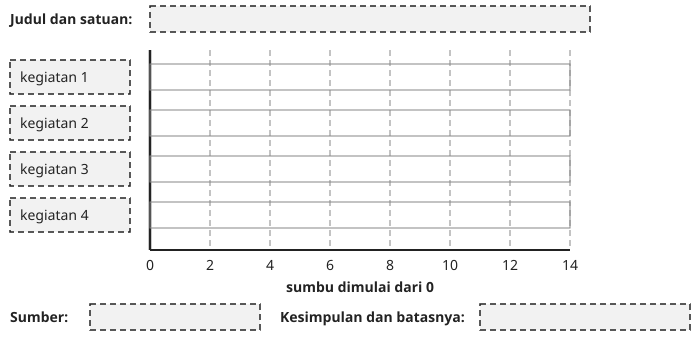

**Ingat dulu:** Tanpa melihat modul:

1. Jelaskan bagaimana sumbu yang tidak mulai dari 0 bisa menyesatkan pembaca grafik. ______
2. Tulis `for` yang mencetak tiap kunci dan nilai kamus `{"a": 1, "b": 2}`. ______



`[Gambar: kerangka grafik batang mendatar yang masih kosong. Sumbu mendatar berskala 0, 2, 4, ... sampai 14 dan dimulai dari 0. Empat baris kosong untuk empat ekstrakurikuler, masing-masing dengan kotak nama dan jalur kosong untuk menggambar batang. Di atas ada kotak Judul dan satuan, di bawah kotak Sumber, dan satu kotak Kesimpulan beserta batasnya.]`

**Prediksi:** Data rekaan sampah plastik per kelas dalam satu pekan. Program P:

```python
data = {"Kelas A": 9, "Kelas B": 15, "Kelas C": 12, "Kelas D": 18, "Kelas E": 6}
print("Sampah plastik terkumpul per kelas (1 # = 1 kg)")
for nama in data:
    print(nama, "|", "#" * data[nama], data[nama])
```

Program Q sama, tetapi batangnya `"#" * (data[nama] - 5)`.

Pada P, batang Kelas D tampak berapa kali batang Kelas E? ______ Pada Q? ______ Mengapa Q terlihat lebih dramatis padahal datanya sama? ______

**Lengkapi:** Gelas air putih per hari: Senin 5, Selasa 8, Rabu 3. Isi bagian kosong.

```python setengah-jadi
data = {"Senin": 5, "Selasa": 8, "Rabu": 3}
print("Gelas air putih per hari (1 # = 1 gelas)")
for hari in ____:
    print(hari, "|", "#" * ____, data[hari])
print("Terbanyak:", max(____.values()))
```

Tulis keluarannya: ______ Satu kesimpulan beserta batasnya: ______

**Susun:** Empat baris berikut diacak. Susun menjadi program yang mencetak grafik batang teks.

- **A.** `data = {"Kelas A": 9, "Kelas B": 15}`
- **B.** `print("Sampah plastik (1 # = 1 kg)")`
- **C.** `for nama in data:`
- **D.** `print(nama, "|", "#" * data[nama], data[nama])` (menjorok di bawah `for`)

Urutanku: ______ , ______ , ______ , ______ Mengapa B tidak boleh di dalam perulangan? ______

**Latihan:**

1. Buat grafik batang untuk data rekaan empat ekstrakurikuler: 7, 12, 9, dan 5 murid. Gambar pada kerangka di atas, beri judul, satuan, dan sumber, lalu tulis satu kesimpulan beserta batasnya.
2. Pada Q, berapa batang Kelas E, dan apa yang tampak benar atau salah pada gambar itu? ______
3. Sebut tiga hal yang membuat sebuah grafik jujur. ______

**Cek diri:**

- [ ] Aku bisa membuat grafik batang dari data tabel kecil.
- [ ] Aku bisa mengenali sumbu yang menyesatkan.
- [ ] Aku bisa menulis kesimpulan beserta batasnya.

**Catatan cetak (untuk guru, tidak dicetak):** satu lembar A4, satu sampai dua halaman. Kunci ada di modul `SMP9-1-M7`, bagian "Contoh terselesaikan", "Catatan untuk guru" (kunci), dan "Cek mandiri". Lembar tidak memuat kolom nama, kelas, tanggal, atau nilai.
