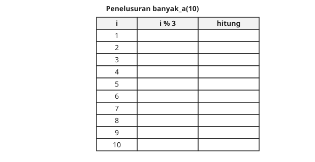

**Ingat dulu:** Tanpa melihat modul:

1. Sebut dua cara berbeda meninjau ulang sebuah jawaban. ______
2. Tulis dua cara berbeda untuk mencetak batang teks `#` sebanyak `n`. ______



`[Gambar: tabel penelusuran untuk banyak_a(10) dengan sepuluh baris. Kolom i berisi 1 sampai 10; kolom i % 3 dan kolom hitung masih kosong untuk diisi.]`

**Prediksi:** Soal: berapa banyak bilangan dari 1 sampai `n` yang habis dibagi 3? Dua program:

```python
def banyak_a(n):
    hitung = 0
    for i in range(1, n + 1):
        if i % 3 == 0:
            hitung = hitung + 1
    return hitung


def banyak_b(n):
    return n // 3


print(banyak_a(10), banyak_b(10))
print(banyak_a(100), banyak_b(100))
print(banyak_a(2), banyak_b(2))
```

Yang tercetak pada tiga baris: ______ / ______ / ______ Apakah dua program selalu memberi angka yang sama? ______

Isi tabel penelusuran pada gambar. Apa yang berbeda pada cara kerja keduanya? ______

**Lengkapi:** Dua cara mencetak batang `#` sebanyak `n`. Isi bagian kosong, lalu tulis apa yang tercetak.

```python setengah-jadi
n = 5
print(____ * n)
batang = ""
for i in range(____):
    batang = batang + ____
print(batang)
```

Yang tercetak: ______

**Susun:** Lima langkah membandingkan dua solusi berikut diacak. Susun menjadi urutan yang masuk akal.

- **A.** Tulis soal dan hasil yang diharapkan untuk contoh kecil.
- **B.** Tulis solusi pertama dan solusi kedua.
- **C.** Jalankan keduanya pada masukan yang sama: kecil, biasa, batas.
- **D.** Bandingkan: benar, banyak langkah, mudah dibaca.
- **E.** Pilih satu dan tulis alasannya.

Urutanku: ______ , ______ , ______ , ______ , ______ Mengapa C harus sebelum D? ______

**Latihan:**

1. Ubah dua program di "Prediksi" menjadi kelipatan 5. Hasilnya untuk `n` = 23: ______
2. Tulis dua program berbeda yang menghitung banyak huruf `"a"` dalam sebuah kata, satu dengan `for` dan satu dengan `count`. Hasil untuk `"banana"`: ______ dan untuk `""`: ______
3. Mengapa dua program yang sama-sama benar masih perlu dibandingkan? ______

**Cek diri:**

- [ ] Aku bisa menulis dua program berbeda untuk satu soal.
- [ ] Aku menguji keduanya dengan masukan yang sama.
- [ ] Aku bisa memilih satu dengan alasan.

**Catatan cetak (untuk guru, tidak dicetak):** satu lembar A4, satu sampai dua halaman. Kunci ada di modul `SMP9-1-M8`, bagian "Contoh terselesaikan", "Catatan untuk guru" (kunci), dan "Cek mandiri". Lembar tidak memuat kolom nama, kelas, tanggal, atau nilai.
