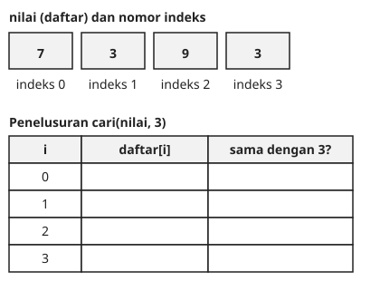

**Ingat dulu:** Tanpa melihat modul:

1. Tulis dua cara memeriksa apakah 7 ada di daftar `[3, 7, 9]`, satu dengan `for` dan satu dengan `in`. ______
2. Tulis fungsi `terbesar(daftar)` tanpa `max`. ______



`[Gambar: daftar nilai berisi 7, 3, 9, 3 dengan nomor indeks 0, 1, 2, 3 di bawah tiap kotak. Di bawahnya tabel penelusuran cari(nilai, 3) dengan kolom i, daftar[i], dan sama?; empat baris dengan kolom i terisi 0 sampai 3, kolom lain kosong.]`

**Prediksi:** Fungsi `cari` mengembalikan nomor indeks nilai yang dicari, atau -1 bila tidak ada. Program P memakai daftar pada gambar:

```python
def cari(daftar, x):
    for i in range(len(daftar)):
        if daftar[i] == x:
            return i
    return -1


nilai = [7, 3, 9, 3]
print(cari(nilai, 3))
print(cari(nilai, 5))
print(cari(nilai, 9))
```

Yang tercetak pada tiga baris: ______ / ______ / ______ Mengapa -1 dipakai, bukan 0? ______

Isi tabel penelusuran pada gambar. Mana yang dikembalikan bila nilainya muncul dua kali? ______

**Lengkapi:** Pengurutan dengan memilih yang terkecil: tiap putaran mencari indeks nilai terkecil dari sisa daftar lalu menukarnya ke depan. Isi bagian kosong.

```python setengah-jadi
def urutkan(daftar):
    for i in range(len(daftar)):
        k = i
        for j in range(i + 1, len(daftar)):
            if daftar[j] ____ daftar[k]:
                k = j
        sementara = daftar[i]
        daftar[i] = daftar[k]
        daftar[k] = ____
    return daftar


print(urutkan([4, 9, 2, 7]))
```

Telusuri `urutkan([4, 9, 2, 7])`. Yang tercetak: ______

**Susun:** Lima langkah pencarian setengah-setengah berikut diacak. Susun menjadi urutan yang masuk akal.

- **A.** Isi `bawah` dengan 0 dan `atas` dengan indeks terakhir.
- **B.** Selama `bawah` belum melewati `atas`, hitung `tengah`.
- **C.** Bila isi `tengah` sama dengan yang dicari, kembalikan `tengah`.
- **D.** Bila tidak sama, geser `bawah` ke `tengah + 1` atau `atas` ke `tengah - 1`, lalu ulangi dari B.
- **E.** Bila perulangan selesai, kembalikan -1.

Urutanku: ______ , ______ , ______ , ______ , ______ Mengapa E paling akhir? ______

**Latihan:**

1. Ubah `cari` menjadi `banyak(daftar, x)` yang mengembalikan berapa kali `x` muncul. Hasil `banyak([7, 3, 9, 3], 3)`: ______
2. Tulis `ada(daftar, x)` yang mengembalikan `True` atau `False` tanpa `in`. ______
3. Mengapa pencarian setengah-setengah tidak boleh dipakai pada daftar yang belum terurut? ______

**Cek diri:**

- [ ] Aku bisa menulis fungsi pencarian yang mengembalikan indeks atau -1.
- [ ] Aku bisa menelusuri pencarian setengah-setengah.
- [ ] Aku bisa menyebut syaratnya.

**Catatan cetak (untuk guru, tidak dicetak):** satu lembar A4, satu sampai dua halaman. Kunci ada di modul `SMP9-1-M9`, bagian "Contoh terselesaikan", "Catatan untuk guru" (kunci), dan "Cek mandiri". Lembar tidak memuat kolom nama, kelas, tanggal, atau nilai.
