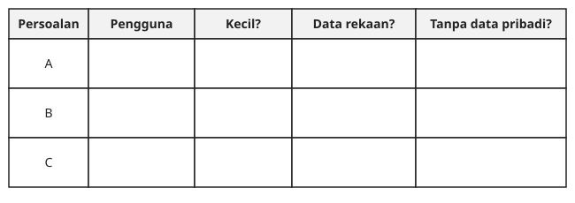

**Ingat dulu:** Tanpa melihat modul:

1. Sebut tiga pertanyaan untuk memeriksa kredibilitas sebuah sumber. ______
2. Tulis tiga kasus uji untuk program yang membaca data kecil: biasa, kosong, dan di batas. ______

`[Gambar: tabel penyaringan dengan baris persoalan A, B, dan C. Kolom: Pengguna, Kecil?, Data rekaan?, dan Tanpa data pribadi?. Semua sel masih kosong untuk diisi.]`

**Prediksi:** Proyek akhir berjalan tujuh pekan. Tiga persoalan rekaan:

- **A.** "Sampah di seluruh kota tidak terurus."
- **B.** "Jadwal piket kelas ditempel di satu tempat, sehingga petugas sering lupa kapan gilirannya."
- **C.** "Kami ingin tahu siapa saja murid yang sering terlambat."

Persoalan mana yang dapat dikerjakan satu tim dalam tujuh pekan dengan program kecil, tanpa mengumpulkan data pribadi? ______

Satu alasan untuk tiap persoalan: A ______ B ______ C ______

Isi tabel penyaringan pada gambar.

**Lengkapi:** Daftar persoalan timmu sendiri (lima, dari rumah, kelas, atau lingkungan). Isi tabel.

| Persoalan | Pengguna | Kecil? | Data rekaan? | Tanpa data pribadi? |
| --- | --- | --- | --- | --- |
| | | | | |
| | | | | |
| | | | | |
| | | | | |
| | | | | |

**Latihan:**

1. Tulis lima persoalan di sekitarmu yang mungkin dibantu program. ______
2. Beri tanda keempat ciri pada tiap persoalan, lalu pilih satu bersama timmu. ______
3. Tulis ulang persoalan A menjadi persoalan kecil yang bisa diuji. ______

**Cek diri:**

- [ ] Persoalan timku punya pengguna yang bisa ditanya.
- [ ] Persoalan timku kecil dan bisa diuji dengan data rekaan.
- [ ] Persoalan timku tidak memerlukan data pribadi nyata.

**Catatan cetak (untuk guru, tidak dicetak):** satu lembar A4, satu sampai dua halaman. Kunci ada di modul `SMP9-2-M1`, bagian "Contoh terselesaikan", "Catatan untuk guru" (kunci), dan "Cek mandiri". Bagian "Susun" dilewati karena modul tidak memuat soal urutan. Lembar tidak memuat kolom nama, kelas, tanggal, atau nilai.
