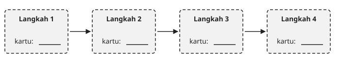

**Ingat dulu:** Tanpa melihat modul:

1. Sebut beda kartu latih dan kartu uji. ______
2. Jelaskan mengapa data pribadi dan kata sandi tidak ditempel ke layanan AI, bahkan saat guru yang mendemonstrasikan. ______
3. Sebut tiga pertanyaan untuk memeriksa kredibilitas sebuah sumber. ______

`[Gambar: empat kotak kosong berurutan dari kiri ke kanan berlabel Langkah 1, Langkah 2, Langkah 3, dan Langkah 4, dihubungkan panah. Di bawah tiap kotak ada garis untuk menulis huruf kartu.]`

**Prediksi:** Dua kasus rekaan. **Kasus P:** Murid-01 menyerahkan tugas yang dikerjakan seluruhnya oleh AI, lalu pekan depan diminta mengerjakan soal serupa tanpa AI. **Kasus Q:** ada video rekaan tokoh "Pak Contoh" yang mengajak orang mengirim uang ke nomor tertentu; suaranya mirip, tetapi tidak ada media resmi yang memberitakannya.

Apa yang mungkin terjadi pada Murid-01 di soal tanpa AI, dan mengapa? ______

Percayakah kamu pada video Pak Contoh, dan apa langkah pertamamu? ______

**Lengkapi:** Tulis dua aturan pakai AI usulanmu dan alasannya.

| Aturan usulanku | Alasanku |
| --- | --- |
| | |
| | |

**Susun:** Empat kartu langkah memeriksa konten mencurigakan berikut diacak: (A) putuskan sebarkan atau tidak; (B) cari sumber resmi lain; (C) berhenti dan jangan sebarkan; (D) cari siapa yang pertama menerbitkan dan kapan.

Tulis huruf kartu pada tiap kotak di gambar. Urutanku: ______ , ______ , ______ , ______

**Latihan:**

1. Dua kasus rekaan: (a) pesan suara "kepala sekolah" meminta kata sandi kelas; (b) AI menyebut tahun berdirinya "Sekolah Contoh" tanpa sumber. Tulis jenis masalahnya untuk tiap kasus. (a) ______ (b) ______
2. Tulis tiga pertanyaan untuk memeriksa sebuah video yang mengajak orang melakukan sesuatu. ______
3. Jelaskan dengan kata sendiri beda memakai AI sebagai alat bantu dan mengalihkan pekerjaan berpikir ke AI. ______

**Cek diri:**

- [ ] Aku tidak menempelkan data pribadi atau kata sandi ke layanan AI.
- [ ] Aku memeriksa asal konten sebelum membagikannya.
- [ ] Aku mengerjakan dulu sendiri sebelum meminta bantuan siapa pun.

**Catatan cetak (untuk guru, tidak dicetak):** satu lembar A4, satu sampai dua halaman. Kunci ada di modul `SMP9-2-M10`, bagian "Contoh terselesaikan", "Catatan untuk guru" (kunci), dan "Cek mandiri". Lembar tidak memuat kolom nama, kelas, tanggal, atau nilai.
