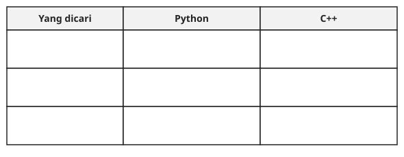

**Ingat dulu:** Tanpa melihat modul:

1. Tulis `cari(daftar, x)` yang mengembalikan indeks atau -1. ______
2. Tulis dari ingatan fungsi yang mencari nilai di kamus dan memberi daftar kosong bila kuncinya tidak ada. ______



`[Gambar: tabel dengan tiga kolom: Yang dicari, Python, dan C++. Tiga baris isian yang masih kosong untuk mencatat hal yang dicari saat membaca kode bahasa lain dan di mana kamu menemukannya di tiap versi.]`

**Prediksi:** Program Python P:

```python
def cari(daftar, x):
    for i in range(len(daftar)):
        if daftar[i] == x:
            return i
    return -1


nilai = [7, 3, 9, 3]
print(cari(nilai, 3))
print(cari(nilai, 5))
print(cari(nilai, 9))
```

Yang tercetak pada tiga baris: ______ / ______ / ______ Telusuri `i` dan `daftar[i]` untuk `cari(nilai, 3)`: ______

Sekarang baca versi C++ (hanya dibaca):

```cpp
#include <iostream>
#include <vector>

int cari(const std::vector<int>& daftar, int x) {
    for (int i = 0; i < static_cast<int>(daftar.size()); i++) {
        if (daftar[i] == x) {
            return i;
        }
    }
    return -1;
}

int main() {
    std::vector<int> nilai = {7, 3, 9, 3};
    std::cout << cari(nilai, 3) << "\n";
    std::cout << cari(nilai, 5) << "\n";
    std::cout << cari(nilai, 9) << "\n";
    return 0;
}
```

Isi tabel pada gambar. Apa arti `int` di depan `cari` dalam C++? ______

**Lengkapi:** Terjemahkan fungsi Python ke pseudocode. Isi bagian kosong.

```python
def terbesar(daftar):
    hasil = daftar[0]
    for n in daftar:
        if n > hasil:
            hasil = n
    return hasil
```

```text setengah-jadi
FUNGSI terbesar(daftar)
  hasil <- daftar[0]
  UNTUK SETIAP n DALAM daftar
    JIKA n ____ hasil MAKA
      hasil <- ____
  KEMBALIKAN ____
```

**Susun:** Lima baris pseudocode berikut diacak. Susun menjadi pseudocode `cari` (indentasi boleh kamu tambahkan).

- **A.** `JIKA daftar[i] = x MAKA`
- **B.** `KEMBALIKAN -1`
- **C.** `FUNGSI cari(daftar, x)`
- **D.** `KEMBALIKAN i`
- **E.** `UNTUK i DARI 0 SAMPAI panjang(daftar) - 1`

Urutanku: ______ , ______ , ______ , ______ , ______

**Latihan:**

1. Pada versi C++, apa yang dicetak untuk `cari(nilai, 7)`? Bagian mana yang kamu telusuri? ______
2. Bila `nilai` berubah menjadi `{4, 4, 8}`, tulis tiga keluaran program C++ untuk `cari(nilai, 4)`, `cari(nilai, 5)`, dan `cari(nilai, 8)`. ______ / ______ / ______
3. Terjemahkan `def jumlah(daftar):` berisi `total = 0`, `for n in daftar:` dengan `total = total + n`, dan `return total` ke pseudocode. ______

**Cek diri:**

- [ ] Aku menebak keluaran sebelum membaca versi C++.
- [ ] Aku menunjuk perulangan dan kondisi di tiap versi.
- [ ] Aku menulis satu pseudocode tanpa melihat contoh.

**Catatan cetak (untuk guru, tidak dicetak):** satu lembar A4, satu sampai dua halaman. Kunci ada di modul `SMP9-2-M11`, bagian "Contoh terselesaikan", "Catatan untuk guru" (kunci), dan "Cek mandiri". Lembar tidak memuat kolom nama, kelas, tanggal, atau nilai.
