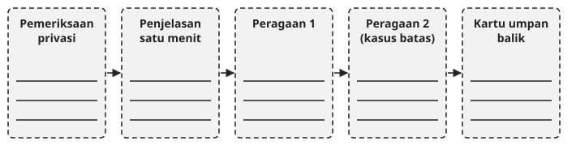

**Ingat dulu:** Tanpa melihat modul:

1. Sebut empat dari tujuh bagian laporan dan satu hal yang tidak boleh ada di slide. ______
2. Sebut apa yang boleh dan yang tidak boleh dibagikan pada pameran produkmu. ______

`[Gambar: lima kotak kosong berurutan dengan panah: Pemeriksaan privasi, Penjelasan satu menit, Peragaan 1, Peragaan 2 (kasus batas), dan Kartu umpan balik. Tiap kotak punya tiga garis untuk menulis isi rencana timmu.]`

**Prediksi:** Dua stasiun rekaan pada pameran kelas:

- **Stasiun X.** Layar menampilkan jadwal piket kelas sungguhan dengan nama lengkap teman dan nomor ponsel ketua, dan penjaga stasiun hanya membaca layar.
- **Stasiun Y.** Penjaga menjelaskan satu menit, lalu meragakan masukan `  RABU ` dan masukan kosong pada jadwal rekaan `Murid-01` sampai `Murid-05`. Ia menunjukkan satu perbaikan dan mengajak pengunjung mengisi kartu umpan balik.

Stasiun mana yang melanggar aturan berbagi karya, dan mengapa? ______

Stasiun mana yang lebih membantu pengunjung memahami produk? ______

**Lengkapi:** Rencana stasiun untuk produk timmu. Isi lima kotak pada gambar.

**Latihan:**

1. Tulis ulang Stasiun X menjadi stasiun yang mengikuti aturan pameran. ______
2. Latih penjelasan satu menit dengan penghitung waktu, lalu tulis satu pertanyaan yang kamu harap ditanyakan pengunjung. ______
3. Sebutkan satu temuan dan satu perbaikan kepada tim lain, lalu catat satu hal yang masih kurang jelas dari kartu umpan balik mereka. ______

**Cek diri:**

- [ ] Stasiunku punya penjelasan satu menit dan satu peragaan.
- [ ] Peragaan memakai data rekaan dan nama samaran.
- [ ] Ada kartu umpan balik tanpa nama.

**Catatan cetak (untuk guru, tidak dicetak):** satu lembar A4, satu sampai dua halaman. Kunci ada di modul `SMP9-2-M12`, bagian "Contoh terselesaikan", "Catatan untuk guru" (kunci), dan "Cek mandiri". Bagian "Susun" dilewati karena minggu pameran memakai rencana stasiun, bukan satu program berurutan. Lembar tidak memuat kolom nama, kelas, tanggal, atau nilai.
